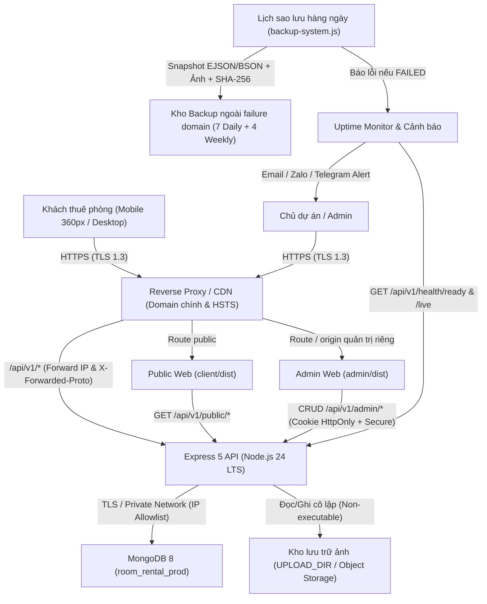
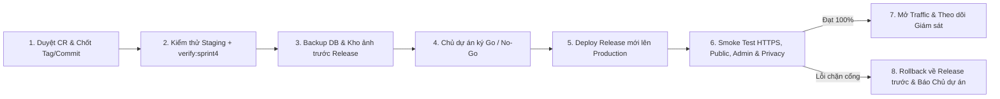

# Sprint 4 — Nghiệm thu, Hardening Bảo mật, Sao lưu/Khôi phục và Triển khai Production (Go-Live)

## 1. Thông tin sprint

| Hạng mục | Nội dung |
| :--- | :--- |
| **Tên sprint** | Sprint 4 — Nghiệm thu, Hardening Bảo mật, Sao lưu/Khôi phục và Triển khai Production (Go-Live) |
| **Thời gian đề xuất** | 2 tuần (10 ngày làm việc) |
| **Mục tiêu chính** | Đóng băng và kiểm chứng toàn diện ma trận nghiệm thu `AT-01`–`AT-49` (tài liệu `10_Testing_Acceptance.md`), thiết lập kiến trúc tách biệt môi trường `Staging` và `Production`, cấu hình tên miền/HTTPS/TLS và bảo mật cookie/CORS/headers (`NFR-04`, `NFR-09`, `NFR-14`), xây dựng cơ chế sao lưu tự động **MongoDB 8 + Kho ảnh** theo chuẩn **7 bản ngày + 4 bản tuần** kèm diễn tập khôi phục thực tế đạt `RPO ≤ 24 giờ` & `RTO ≤ 1 ngày làm việc` (`NFR-11`, `AT-37`, `AT-39`), thiết lập giám sát `/api/v1/health/live` & `/api/v1/health/ready` + cảnh báo sự cố (`FR-17`, `NFR-10`, `NFR-12`, `AT-36`, `AT-49`), làm sạch dữ liệu thử nghiệm và nhập dữ liệu phòng thật (chuẩn **5 phường Quận Bình Thạnh năm 2026** & danh mục tiện nghi mới có `Thang máy`) (`AT-44`), bàn giao Runbook vận hành và ký biên bản Go-Live (`UC-10`, `UC-11`, `NFR-15`, `AT-41`, `AT-47`). |
| **Use case trọng tâm** | `UC-10` (Phát hành và xác nhận sẵn sàng production), `UC-11` (Khôi phục sau sự cố dữ liệu/dịch vụ), kết hợp kiểm thử hồi quy đầu-cuối `UC-01`–`UC-09`. |
| **Yêu cầu liên quan** | Toàn bộ `BRQ-01`–`BRQ-06`; `FR-01`–`FR-19` (trọng tâm `FR-13`–`FR-18`); `NFR-01`–`NFR-18` (trọng tâm `NFR-04`, `NFR-08`–`NFR-16`); `RULE-01`–`RULE-13`; toàn bộ `AT-01`–`AT-49` (đặc biệt Production Acceptance Gate `AT-30`–`AT-49`); `ADR-01`–`ADR-08`. |
| **Kiến trúc ứng dụng & dữ liệu** | Hai cổng frontend độc lập `client/` (Public Web) & `admin/` (Admin Web) + Backend Express 5 (`server/`) + **MongoDB 8** (driver chính thức `mongodb`, mảng `images[]` nhúng nguyên tử trong `room_listings`) + Kho lưu trữ ảnh tách biệt theo môi trường (`UPLOAD_DIR` / Object Storage). |
| **Trạng thái Sprint 4** | **Sẵn sàng triển khai (Planning Baseline đã khóa)**. |

### 1.1. Sprint Goal

> Khép lại Sprint 4, hệ thống **Ngọc Toàn — Hệ thống Phòng trọ Bình Thạnh** chuyển từ bản hoàn thiện kỹ thuật tại local (cuối Sprint 3) sang trạng thái **sẵn sàng vận hành Production thực tế**: truy cập ổn định qua tên miền thuộc quyền sở hữu của chủ dự án với **HTTPS/TLS hợp lệ**, dữ liệu mẫu được thay thế hoàn toàn bằng **dữ liệu phòng thật tại 5 phường Quận Bình Thạnh năm 2026**, toàn bộ **49 kịch bản nghiệm thu `AT-01`–`AT-49` đạt chuẩn Go-Live**, có cơ chế **sao lưu tự động 7 bản ngày + 4 bản tuần** đã diễn tập khôi phục thành công (`RPO ≤ 24 giờ`, `RTO ≤ 1 ngày làm việc`), có **giám sát/cảnh báo**, và chủ dự án nắm toàn quyền sở hữu hạ tầng cùng bộ **Runbook vận hành & xử lý sự cố** đầy đủ.

### 1.2. Tiếp nối kết quả từ Sprint 0–3 & Khoảng cách cần đóng trong Sprint 4

| Thành phần / Năng lực | Nền tảng đã hoàn thành ở Sprint 0–3 | Khoảng cách cần hoàn tất trong Sprint 4 (Go-Live) |
| :--- | :--- | :--- |
| **Cơ sở dữ liệu MongoDB 8 & Chỉ mục** | 4 collections (`room_listings`, `admin_accounts`, `admin_sessions`, `audit_events`) cùng 8 indexes khởi tạo idempotent qua `npm --prefix server run db:init` (gồm `idx_public_rooms_area`, `idx_public_rooms_amenities`, `idx_public_rooms_ward`...). | Tách riêng database `Staging` và `Production`, thiết lập kết nối private/IP allowlist + TLS + quyền tài khoản tối thiểu (`AT-48`), khởi tạo sạch DB production không chứa dữ liệu `seed-sprint2` hay `room_rental_perf`. |
| **Kiến trúc 2 cổng tách biệt (`client/` & `admin/`)** | `client/` và `admin/` build độc lập bằng Vite; `server/src/server.js` khóa CORS chéo `ADMIN_ORIGIN` trên `/api/v1/admin/*`; frontend khách hàng không có đường dẫn `/admin/*`. | Cấu hình domain/subdomain thật qua Reverse Proxy HTTPS (`HTTP -> HTTPS 301`), bật cookie `Secure` trên phiên admin, thêm `TRUST_PROXY` để giới hạn tốc độ đăng nhập theo đúng IP thật qua proxy, kiểm tra build `dist` sạch bí mật (`AT-38`, `AT-48`). |
| **Nghiệp vụ 2026 & Trải nghiệm Quản trị/Khách** | Chuẩn hóa 5 phường Bình Thạnh 2026 (`1685/NQ-UBTVQH15`), tiện nghi `Thang máy` (bỏ `Máy giặt`), tạo tin chọn ảnh + ảnh bìa trước khi lưu nháp `DRAFT`, xuất bản chuyển về `/`, lọc đa tiêu chí + `amenities` + `AbortController` + `ETag`/`304`. | Provision tài khoản admin thật (`npm --prefix server run admin:provision`), đổi mật khẩu tạm lần đầu (`AT-35`), nhập và rà soát toàn bộ tin phòng thật + cờ công khai địa chỉ/liên hệ (`AT-43`, `AT-44`). |
| **Hiệu năng & Tương thích** | Benchmark 500 tin trên DB riêng `room_rental_perf` với 4G throttling (`360×800`) đạt **`p75 = 1352.1 ms`** (`≤ 3000 ms`) và **`maxCLS = 0.0001`** (`< 0.1`); mọi truy vấn lọc chính dùng `IXSCAN`. | Chạy xác minh tương thích trình duyệt mục tiêu (`Chrome`, `Edge`, `Safari Mobile` hoặc tương đương), xác minh độ tươi cache public `≤ 60 giây` trên domain thật và smoke test sau release/rollback (`AT-45`, `AT-46`, `AT-47`). |
| **Sao lưu, Khôi phục, Retention & Giám sát** | Đã có `/api/v1/health/live`, `/api/v1/health/ready`, bảng `audit_events` và trường `deletedAt` xóa mềm cơ bản. | Xây dựng bộ công cụ sao lưu tự động **MongoDB 8 + Kho ảnh** (**7 daily + 4 weekly** khác failure domain), diễn tập khôi phục cô lập (`AT-39`), test cảnh báo backup lỗi (`AT-37`), chính sách retention 90 ngày (`DAT-03`), kết nối uptime monitor + Runbook bàn giao (`AT-36`, `AT-41`, `AT-49`). |

---

## 2. Tài liệu và quyết định kiến trúc liên quan

### 2.1. Tài liệu nguồn bắt buộc tuân thủ

| Tài liệu | Vai trò đối với Sprint 4 |
| :--- | :--- |
| [Sprint 0 — Setup](<./Sprint_0_Setup.md>) | Quy chuẩn biến môi trường, MongoDB 8, lệnh `db:init` và kiểm tra sức khỏe nền tảng. |
| [Sprint 1 — Khu quản trị và quản lý tin phòng](<./Sprint_1_Admin_Quan_ly_Tin_Phong.md>) | Quy chuẩn xác thực `scrypt`, `admin_sessions`, rate-limit, provisioning admin, xóa mềm/khôi phục và bảo mật upload. |
| [Sprint 2 — Hệ thống Khách hàng: Danh sách, Tìm kiếm, Lọc và Chi tiết Phòng](<./Sprint_2_Khach_Xem_Danh_Sach_Chi_Tiet.md>) | Quy chuẩn tách biệt `client/` – `admin/`, Public Allowlist JSON, bảo vệ `privateAddress` và bộ test `verify-sprint2-public.js`. |
| [Sprint 3 — Tìm kiếm, Lọc nâng cao và Tối ưu UX/Hiệu năng](<./Sprint_3_Tim_Kiem_Loc_Nang_Cao_Toi_Uu_UX_Hieu_Nang.md>) | Benchmark 500 tin `NFR-13` (`p75 = 1352.1 ms`), tối ưu `ETag`/`304`, 5 phường 2026, tiện nghi `Thang máy` và bộ test `verify-sprint3-perf.js`. |
| [03_Requirements.md](<../Tài liệu BA/Đợt 1 - Phân tích nghiệp vụ/03_Requirements.md>) | Baseline production Mục 8 (`FR-13`–`FR-19`, `NFR-09`–`NFR-18`, điều kiện xuất bản 8.2) & `RULE-08`–`RULE-13`. |
| [04_Use_Case.md](<../Tài liệu BA/Đợt 1 - Phân tích nghiệp vụ/04_Use_Case.md>) | Đặc tả chi tiết `UC-09` (Xóa mềm/khôi phục), `UC-10` (Phát hành production) và `UC-11` (Khôi phục sau sự cố). |
| [05_Business_Process.md](<../Tài liệu BA/Đợt 1 - Phân tích nghiệp vụ/05_Business_Process.md>) | Quy trình go-live (Mục 8.1), smoke check phát hành (8.2), lịch vận hành (8.3) và khôi phục/rollback (8.4). |
| [06_Data_Analysis.md](<../Tài liệu BA/Đợt 2 - Phân tích thiết kế/06_Data_Analysis.md>) | Baseline dữ liệu production Mục 11: cấu trúc BSON MongoDB 8, retention xóa mềm/audit 90 ngày (`DAT-01`–`DAT-03`) và backup. |
| [08_System_Architecture.md](<../Tài liệu BA/Đợt 2 - Phân tích thiết kế/08_System_Architecture.md>) | Baseline kiến trúc production Mục 17, yêu cầu `ADR-01`–`ADR-08` và Architecture Go-Live Gate (Mục 17.6). |
| [09_API_Specification.md](<../Tài liệu BA/Đợt 3 - Chuẩn bị phát triển/09_API_Specification.md>) | Hợp đồng chuẩn API công khai, API quản trị và `/api/v1/health/*`. |
| [10_Testing_Acceptance.md](<../Tài liệu BA/Đợt 3 - Chuẩn bị phát triển/10_Testing_Acceptance.md>) | Toàn bộ ma trận `AT-01`–`AT-49`, Production Acceptance Gate (Mục 14) và mẫu Biên bản nghiệm thu (Mục 8 & 14.4). |
| [11_Change_Management.md](<../Tài liệu BA/Đợt 3 - Chuẩn bị phát triển/11_Change_Management.md>) | Chu kỳ phát hành production, phân cấp sự cố `P1`–`P4`, diễn tập backup/restore, ứng phó sự cố bảo mật và biên bản bàn giao (Mục 18). |

### 2.2. Khóa 8 Quyết định Kiến trúc Production (`ADR-01` – `ADR-08`)

Theo Mục 17.5 của `08_System_Architecture.md`, trước khi mở cổng phát hành Production phải khóa rõ 8 quyết định kiến trúc sau:

| Mã ADR | Chủ đề | Quyết định kiến trúc Production đã khóa | Chủ sở hữu / Người duy trì |
| :--- | :--- | :--- | :--- |
| **`ADR-01`** | **Web / API Stack** | Frontend tách 2 SPA build tĩnh **React 19 + Vite** (`client/dist` cho khách và `admin/dist` cho chủ dự án); Backend **Node.js 24 LTS + Express 5** theo kiến trúc modular monolith; gắn phiên bản phát hành `MAJOR.MINOR.PATCH` và tag/commit Git cho mỗi release để quay lui tức thời. | Kỹ sư triển khai & Chủ dự án (`Ngọc Toàn`) |
| **`ADR-02`** | **Database** | **MongoDB 8** (driver chính thức `mongodb`). Bắt buộc xác thực SCRAM-SHA-256 + TLS, **không mở cổng `27017` ra Internet công khai** (chỉ mở trong mạng nội bộ / IP allowlist của backend), tách hoàn toàn DB `room_rental_prod` khỏi `room_rental_staging` và `room_rental_dev`. Toàn bộ 8 index khởi tạo chuẩn qua `npm --prefix server run db:init`. | Chủ dự án đứng tên dịch vụ; Kỹ sư vận hành cấu hình |
| **`ADR-03`** | **Image Storage** | Lưu trữ thông qua lớp trừu tượng `server/src/storage/image-storage.js`: tách khỏi web root có thể thực thi (`UPLOAD_DIR` trên volume bền vững riêng hoặc Object Storage tương thích S3/R2). Giới hạn JPEG/PNG/WebP (`≤ 10 MB/ảnh`, `≤ 15 ảnh/tin`), kiểm tra magic bytes, phát hành qua API/CDN kèm `ETag`/`Last-Modified` và `Cache-Control: public, max-age=60`. | Chủ dự án đứng tên tài khoản storage |
| **`ADR-04`** | **Authentication & Security** | Phiên `admin_session` lưu SHA-256 hash trong `admin_sessions` (TTL `12 giờ`), cookie `HttpOnly; Secure; SameSite=Lax; Path=/api/v1/admin` trên HTTPS production. Chặn CORS chéo nguồn giữa `CLIENT_ORIGIN` và `ADMIN_ORIGIN`; rate-limit đăng nhập (`10` lần sai / `15` phút theo IP thật sau proxy); không có endpoint đăng ký công khai; admin đầu tiên tạo qua `admin:provision` với mật khẩu tạm phải đổi khi kích hoạt (`mustChangePassword: true`). | Backend API + Reverse Proxy |
| **`ADR-05`** | **Domain / TLS & Routing** | Tên miền chính thức và tài khoản DNS thuộc **Chủ dự án (`Ngọc Toàn`)** (ví dụ `phongtrongocToan.vn` cho khách và `quanly.phongtrongocToan.vn` hoặc route tách origin cho admin). Chứng thư số TLS 1.2/1.3 tự động gia hạn (Let's Encrypt via Caddy/Nginx hoặc Cloudflare SSL Strict), ép chuyển hướng `HTTP -> HTTPS (301)`, bật HSTS (`Strict-Transport-Security`). | Chủ dự án (`Ngọc Toàn`) giữ quyền DNS/Domain |
| **`ADR-06`** | **Monitoring, Log & Alerts** | Readiness/Liveness qua `GET /api/v1/health/live` & `GET /api/v1/health/ready` (không trả secret/URI/stack trace). Log JSON có cấu trúc kèm `requestId` và ghi `audit_events` cho mọi thao tác admin (lọc sạch password/token/cookie). Uptime monitor ngoài kiểm tra mỗi `1–5 phút`, gửi cảnh báo ngay tới Email/Zalo/Telegram của đầu mối khi web down, backup thất bại, dung lượng `> 80%` hoặc TLS còn `< 14 ngày`. | Chủ dự án là đầu mối nhận cảnh báo chính |
| **`ADR-07`** | **Chi phí vận hành định kỳ (Cost)** | Thanh toán minh bạch theo tài khoản chủ dự án gồm 4 nhóm cố định/tháng: (1) Domain `.vn`/`.com`, (2) Compute VPS / PaaS cho Node + MongoDB, (3) Storage / Offsite Backup (`S3/R2/Object Storage`), (4) Uptime/Alert (gói free hoặc trả phí cơ bản). Chủ dự án phê duyệt bảng chi phí thực tế trước khi nhấn Go-Live. | Chủ dự án (`Ngọc Toàn`) phê duyệt & thanh toán |
| **`ADR-08`** | **Backup, Retention & Recovery** | Backup tự động hàng ngày cả MongoDB và Kho ảnh; giữ tối thiểu **7 bản daily + 4 bản weekly** lưu tại vị trí khác failure domain với máy chủ chính. Mục tiêu **`RPO ≤ 24 giờ`**, **`RTO ≤ 1 ngày làm việc`**. Tin xóa mềm (`deletedAt`) và `audit_events` giữ tối thiểu **90 ngày** (`DAT-03`), chỉ purge có xác nhận sau khi có backup. Bắt buộc diễn tập restore thành công trước Go-Live. | Chủ dự án duyệt chính sách; Người được ủy quyền vận hành thực thi |

---

## 3. Phạm vi Sprint 4

### 3.1. Trong phạm vi

1. **Hardening Cấu hình Production, Domain/HTTPS & Bảo mật (`NFR-04`, `NFR-09`, `NFR-14`, `AT-34`, `AT-35`, `AT-38`, `AT-48`)**:
   - Nâng cấp `server/src/config/env.js`, `server/src/server.js` và `server/src/middleware/admin-auth.js` để hỗ trợ đầy đủ cấu hình production qua biến môi trường: `TRUST_PROXY`, `COOKIE_SECURE`, cấu hình HTTPS headers (`HSTS`, `X-Content-Type-Options: nosniff`, `X-Frame-Options: DENY`), và kiểm tra nghiêm ngặt khi khởi động nếu thiếu/sai cấu hình an toàn ở `NODE_ENV=production`.
   - Cấu hình build tĩnh tối ưu cho `client/` (`VITE_API_BASE_URL`) và `admin/` (`VITE_API_BASE_URL`), kiểm tra tự động đảm bảo gói build (`dist/`) không chứa bất kỳ biến bí mật nào.
2. **Hệ thống Sao lưu Tự động, Chính sách Retention 90 ngày & Diễn tập Khôi phục (`NFR-11`, `UC-11`, `AT-37`, `AT-39`)**:
   - Xây dựng script sao lưu toàn hệ thống `server/scripts/backup-system.js`: đóng gói đồng thời toàn bộ 4 collections MongoDB 8 (BSON/EJSON nguyên vẹn kiểu `Date`/số/mảng) + thư mục ảnh `UPLOAD_DIR`, tạo `manifest.json` kèm chữ ký SHA-256 từng tệp, tự động xoay vòng giữ **7 bản `daily` + 4 bản `weekly`**, và ghi nhận trạng thái `SUCCESS`/`FAILED` kèm cơ chế kích hoạt cảnh báo khi lỗi (`AT-37`).
   - Xây dựng script khôi phục cô lập `server/scripts/restore-system.js`: kiểm tra checksum từ `manifest.json`, phục hồi sang database và kho ảnh cô lập (hoặc phục hồi sự cố có xác nhận), kiểm tra 100% liên kết `room_listings.images[]` ↔ tệp ảnh vật lý, chạy `db:init` khôi phục 8 index và đo thời gian khôi phục đạt `RTO ≤ 1 ngày làm việc` (`AT-39`).
   - Xây dựng script dọn dẹp theo chính sách retention 90 ngày `server/scripts/purge-expired.js` (`DAT-03`) chạy chế độ `--dry-run` mặc định để rà soát tin xóa mềm quá 90 ngày và ảnh mồ côi an toàn.
3. **Giám sát Sức khỏe, Audit Log & Cảnh báo Sự cố (`FR-17`, `NFR-10`, `NFR-12`, `AT-36`, `AT-49`)**:
   - Rà soát và kiểm thử tự động `/api/v1/health/live` & `/api/v1/health/ready` ở cả trạng thái MongoDB sống (`200`) và giả lập mất kết nối DB (`503`), đảm bảo `0` rò rỉ `MONGODB_URI`, token hay stack trace (`AT-36`).
   - Kiểm chứng đầy đủ nhật ký `audit_events` cho toàn bộ thao tác nhạy cảm và cơ chế lọc bí mật trên log máy chủ.
   - Thiết lập kịch bản kiểm tra uptime & cảnh báo (`AT-49`).
4. **Chuẩn hóa Dữ liệu Thật & Làm sạch Dữ liệu Demo (`FR-01`–`FR-08`, `NFR-17`, `AT-35`, `AT-43`, `AT-44`)**:
   - Quy trình làm sạch triệt để dữ liệu seed/benchmark trên môi trường phát hành, chạy `npm --prefix server run admin:provision` cấp tài khoản chủ dự án duy nhất và đổi mật khẩu tạm ngay lần đầu.
   - Nhập bộ tin phòng thật tại **5 phường Quận Bình Thạnh năm 2026** (`Phường Gia Định`, `Phường Bình Thạnh`, `Phường Bình Lợi Trung`, `Phường Thạnh Mỹ Tây`, `Phường Bình Quới`), rà soát giá, diện tích, tiện nghi (`Thang máy`...), ảnh bìa, bản xem trước riêng tư (`AT-31`) và cờ `allowExactAddress` / `allowPublicPhone` / `allowPublicZalo` trước khi xuất bản (`AT-43`, `AT-44`).
5. **Tổng duyệt Ma trận `AT-01`–`AT-49`, Diễn tập Phát hành/Rollback & Bàn giao (`UC-10`, `NFR-15`, `AT-30`–`AT-49`)**:
   - Xây dựng bộ kiểm thử cổng Go-Live `server/scripts/verify-sprint4-golive.js` bao quát `AT-30`–`AT-49` (chế độ cô lập không làm hỏng `room_rental_dev`) và chạy lại hồi quy `verify-sprint2-public.js` + `verify-sprint3-perf.js`.
   - Diễn tập quy trình phát hành chuẩn và quay lui khẩn cấp (`Rollback Drill` — `AT-47`), bàn giao **Runbook Vận hành** và hoàn thiện **Biên bản Nghiệm thu Go-Live** cho Chủ dự án (`AT-41`).

### 3.2. Ngoài phạm vi Sprint 4 (Giai đoạn sau Go-Live / Phase 2)

| Hạng mục | Lý do giữ ngoài phạm vi MVP / Go-Live |
| :--- | :--- |
| Đặt cọc/giữ phòng, thanh toán trực tuyến, hợp đồng điện tử, quản lý người thuê và hóa đơn điện nước | Nằm ngoài phạm vi MVP theo Mục 6 của `03_Requirements.md`; cần quy trình Change Request (`11_Change_Management.md`) ở giai đoạn sau. |
| Nhiều tài khoản phân quyền admin, chatbot, đánh giá/bình luận khách thuê | MVP vận hành theo mô hình một chủ dự án quản trị đơn giản, an toàn (`BRQ-03`, `RULE-12`). |
| Đồng bộ chéo sang các sàn bất động sản bên thứ ba | Sẽ cân nhắc ở Phase 2 sau khi website chính thức vận hành ổn định. |

---

## 4. Kiến trúc Triển khai Production, Tách biệt Môi trường & Bảo mật

### 4.1. Sơ đồ kiến trúc triển khai Production



### 4.2. Ma trận tách biệt 4 môi trường

Để tuân thủ tuyệt đối nguyên tắc không trộn dữ liệu thử nghiệm với dữ liệu thật (`10_Testing_Acceptance.md` mục 3 & `08_System_Architecture.md` mục 14, 17.1):

| Môi trường | `MONGODB_DB_NAME` | Kho lưu trữ ảnh (`UPLOAD_DIR`) | Nguồn truy cập (`CLIENT_ORIGIN` / `ADMIN_ORIGIN`) | Dữ liệu chứa & Mục đích |
| :--- | :--- | :--- | :--- | :--- |
| **Local / Dev** | `room_rental_dev` | `server/uploads` | `http://127.0.0.1:5173` & `http://127.0.0.1:5174` | Phát triển tính năng và kiểm thử thủ công ở local (`verify:sprint2`). |
| **Benchmark / Perf** | `room_rental_perf` | `server/uploads-perf` | `http://127.0.0.1:5173` (chỉ đọc thử tải) | Bộ 500 bản ghi tổng hợp Sprint 3 phục vụ đo `p75 ≤ 3s` (`verify:sprint3`), cách ly hoàn toàn. |
| **Staging / Restore-Test** | `room_rental_staging` / `room_rental_restore_test` | `server/uploads-staging` / `server/uploads-restore-test` | URL staging nội bộ có bảo vệ | Nghiệm thu trước phát hành, kiểm thử migration và **diễn tập khôi phục từ backup (`AT-39`)**. |
| **Production (Go-Live)** | `room_rental_prod` | Volume bền vững riêng / Object Storage ngoài repo | Domain HTTPS chính thức của chủ dự án | **100% dữ liệu phòng thật đã được chủ dự án duyệt**, có backup tự động 7 daily + 4 weekly. |

### 4.3. Tiêu chuẩn Hardening Bảo mật Production (`NFR-04`, `NFR-09`, `NFR-14`, `AT-38`, `AT-48`)

1. **Xử lý Reverse Proxy & Cookie phiên quản trị (`ADMIN_ORIGIN`)**:
   - Khi chạy sau Nginx/Caddy/Cloudflare với `NODE_ENV=production`, backend bật `TRUST_PROXY` (ví dụ `1` hop) để `request.ip` phản ánh đúng IP máy khách cho cơ chế `loginAttempts` rate-limiter (`10` lần sai / `15` phút) và không bị người dùng khác làm nghẽn IP chung của proxy.
   - Cookie `admin_session` tự động gắn thuộc tính `Secure` khi `NODE_ENV=production` hoặc `COOKIE_SECURE=true` (`HttpOnly; Secure; SameSite=Lax; Path=/api/v1/admin; Max-Age=43200`).
2. **Bảo mật HTTP Headers & Chống lạm dụng**:
   - Reverse Proxy ép chuyển hướng mọi yêu cầu `HTTP (80)` sang `HTTPS (443)` với mã `301`, bật `Strict-Transport-Security` (`HSTS`), đảm bảo `0` mixed content trong tải trang và API (`AT-38`).
   - Backend giữ nguyên `app.disable("x-powered-by")`, `helmet()` đầy đủ (`X-Content-Type-Options: nosniff`, `X-Frame-Options: DENY`), giới hạn `express.json({ limit: "1mb" })`, từ chối mọi preflight/request trái origin theo `CLIENT_ORIGIN` và `ADMIN_ORIGIN`.
   - Thư mục ảnh upload nằm tách biệt khỏi web root, phục vụ ảnh qua route kiểm soát `GET /api/v1/public/rooms/:roomId/images/:imageId/file` (tin `PUBLISHED`) và `GET /api/v1/admin/rooms/:roomId/images/:imageId/file` (có phiên admin), tuyệt đối không thực thi mã.
3. **Bảo vệ Bí mật & Database (`AT-48`)**:
   - Toàn bộ cấu hình nhạy cảm (`MONGODB_URI`, credential storage, webhook cảnh báo) nạp từ biến môi trường/Secret Store của máy chủ, tuyệt đối không commit `.env` production vào Git.
   - Kiểm tra tự động thư mục build frontend `client/dist` và `admin/dist` xác nhận không chứa `MONGODB_URI`, mật khẩu, token hay thông tin nội bộ máy chủ.

---

## 5. Product Backlog Sprint 4

| Mã | Hạng mục | Liên kết BA | Trạng thái đầu vào | Tiêu chí hoàn tất Sprint 4 (Acceptance Criteria) |
| :--- | :--- | :--- | :--- | :--- |
| `S4-01` | Hardening cấu hình môi trường & bảo mật Production (`TRUST_PROXY`, cookie `Secure`, HSTS/TLS, kiểm soát secret) | `NFR-04`, `NFR-09`, `NFR-14`, `AT-34`, `AT-38`, `AT-48` | Đã có `helmet`, `env.js` cơ bản và cookie `HttpOnly` | `env.js`, `server.js`, `admin-auth.js` hỗ trợ `TRUST_PROXY` và `COOKIE_SECURE`; `NODE_ENV=production` bật `Secure` cookie; rà quét `dist/` sạch 100% secret. |
| `S4-02` | Xây dựng công cụ Sao lưu tự động (`backup-system.js`) MongoDB 8 + Kho ảnh & xoay vòng 7 daily + 4 weekly | `NFR-11`, `UC-10`, `06_Data_Analysis` 11.6 | Chưa có script backup chuẩn | Sao lưu nguyên vẹn 4 collections + thư mục ảnh + `manifest.json` SHA-256; tự động xoay vòng giữ 7 bản ngày + 4 bản tuần; không xóa bản cũ nếu bản mới lỗi. |
| `S4-03` | Xây dựng công cụ Khôi phục cô lập (`restore-system.js`), diễn tập Restore Drill & mô phỏng cảnh báo backup lỗi | `NFR-11`, `NFR-12`, `UC-11`, `AT-37`, `AT-39` | Chưa có script restore drill | Restore vào DB/kho ảnh cô lập thành công 100%, xác minh checksum & liên kết toàn bộ `images[]`, ghi nhận thời gian đạt `RTO ≤ 1 ngày làm việc`, mô phỏng job lỗi tạo cảnh báo đúng (`AT-37`). |
| `S4-04` | Chính sách Retention 90 ngày & công cụ dọn dẹp an toàn (`purge-expired.js`) | `RULE-11`, `DAT-03`, `FR-14`, `AT-32`, `AT-33` | Đã có soft-delete (`deletedAt`) & khôi phục | Mặc định `--dry-run` chỉ báo cáo bản ghi quá 90 ngày và ảnh mồ côi; chỉ purge khi truyền cờ xác nhận tường minh sau khi kiểm tra tồn tại backup hợp lệ. |
| `S4-05` | Kiểm chứng Giám sát `/api/v1/health/*`, Audit Log & Hệ thống cảnh báo sự cố (`AT-36`, `AT-49`) | `FR-17`, `NFR-10`, `NFR-12`, `AT-36`, `AT-49` | Đã có `/health/live`, `/health/ready` và `audit_events` | Kiểm thử `health/ready` trả `200` khi khỏe và `503` khi mất DB mà không lộ secret/URI; toàn bộ log & health sạch thông tin nhạy cảm; Uptime check & cảnh báo hoạt động khi mô phỏng down. |
| `S4-06` | Quy trình làm sạch dữ liệu mẫu, khởi tạo Admin thật (`admin:provision`) & nhập/kiểm duyệt dữ liệu phòng thật 2026 | `FR-01`–`FR-08`, `FR-16`, `NFR-17`, `AT-35`, `AT-43`, `AT-44` | DB local đang chứa dữ liệu mẫu Sprint 2–3 | DB production sạch tin demo; tạo tài khoản admin thật + đổi mật khẩu lần đầu; nhập & duyệt tin phòng thật thuộc 5 phường Bình Thạnh 2026 đúng giá, ảnh, tiện nghi (`Thang máy`...) & quyền riêng tư. |
| `S4-07` | Xây dựng bộ Smoke Test sau phát hành & Diễn tập Quay lui (`Release & Rollback Drill`) | `UC-10`, `UC-11`, `NFR-15`, `AT-47` | Chưa có bộ smoke test Go-Live chuẩn | Chạy thành công kịch bản smoke test kiểm tra HTTPS/TLS, public list/detail, filter, admin login, tạo/sửa/ẩn/xóa mềm/khôi phục sau cả release và rollback giả lập. |
| `S4-08` | Xây dựng bộ kiểm thử tự động Cổng Production `verify-sprint4-golive.js` (`AT-30`–`AT-49` & hồi quy `AT-01`–`AT-29`) | `10_Testing_Acceptance` mục 14 | Mới có `verify-sprint2` & `verify-sprint3` | Chạy `npm --prefix server run verify:sprint4` trên DB cô lập xác nhận toàn bộ điều kiện bảo mật, health, backup/restore, audit, retention, privacy và hiệu năng đều `PASS`. |
| `S4-09` | Hoàn thiện **Runbook Vận hành Production & Ứng phó Sự cố (`P1`–`P4`)** | `NFR-15`, `11_Change_Management` mục 18 | Mới có mục kế hoạch sơ bộ | Runbook đầy đủ hướng dẫn sử dụng admin, lịch backup/restore, quy trình deploy/rollback, đầu mối hỗ trợ, xử lý sự cố `P1`–`P4` và bảng chi phí định kỳ. |
| `S4-10` | Nghiệm thu tổng thể, bàn giao quyền sở hữu tài khoản dịch vụ & ký **Biên bản Go-Live** với Chủ dự án | `UC-10`, `AT-41`, `10_Testing_Acceptance` 14.4 | Chờ thực thi sau khi đạt `S4-01`–`S4-09` | Chủ dự án (`Ngọc Toàn`) kiểm tra thực tế trên môi trường production, nắm tài khoản/hướng dẫn vận hành và ký duyệt Biên bản nghiệm thu phát hành. |

---

## 6. Thiết kế Kỹ thuật Chi tiết: Sao lưu, Khôi phục, Retention & Giám sát

### 6.1. Quy trình & Cấu trúc Gói Sao lưu (`server/scripts/backup-system.js`)

Để vừa hỗ trợ bộ công cụ chính thức của MongoDB (`mongodump`/`mongorestore`) vừa đảm bảo chạy ổn định trên mọi máy chủ Windows/Linux (kể cả khi máy chủ chạy Node container không cài sẵn Database Tools):

1. **Thư mục đầu ra tách biệt (`BACKUP_ROOT`)**:
   - Cấu hình qua biến môi trường `BACKUP_ROOT` (mặc định local/staging trỏ ngoài kho source và khác phân vùng/Failure Domain trên production).
   - Quy ước đặt tên gói backup theo UTC: `backup-YYYYMMDD-HHMMSS-<daily|weekly>`.
2. **Nội dung bên trong mỗi gói backup**:
   - `db/*.ejson.gz`: Xuất toàn bộ 4 collections (`room_listings`, `admin_accounts`, `admin_sessions`, `audit_events`) theo chuẩn Extended JSON nén gzip (bảo toàn chính xác kiểu `Date`, số nguyên `Int`, số thực `Double`, mảng nhúng `images[]`) kèm định nghĩa `indexes.json`.
   - `uploads/`: Bản sao nguyên vẹn các tệp ảnh thuộc kho `UPLOAD_DIR` tương ứng với thời điểm chụp.
   - `manifest.json`: Chứa `version`, `backupId`, `backupType` (`daily` / `weekly`), `createdAtUtc`, `sourceDbName`, `counts` (số document mỗi collection), `imageFileCount`, `totalBytes`, danh sách `checksums` (`SHA-256` từng tệp trong `db/` và `uploads/`), và trạng thái cuối (`status: "SUCCESS"` hoặc `"FAILED"` + lý do lỗi đã lọc secret).
3. **Chính sách xoay vòng (Rotation) & Xử lý lỗi (`AT-37`)**:
   - Giữ lại tối thiểu **7 bản `daily` thành công gần nhất** và **4 bản `weekly` thành công gần nhất**.
   - Nếu quá trình sao lưu bị gián đoạn hoặc lỗi checksum: đánh dấu `status: "FAILED"` (hoặc đẩy thông báo lỗi ra kênh cảnh báo/webhook đã cấu hình), **tuyệt đối không xóa bản backup hợp lệ cũ hơn**, đảm bảo trạng thái thất bại không bao giờ bị ghi nhận nhầm là thành công (`AT-37`).

### 6.2. Quy trình Diễn tập Khôi phục Cô lập (`server/scripts/restore-system.js` — `UC-11`, `AT-39`)

| Bước | Thao tác thực hiện tự động / có kiểm soát | Tiêu chí kiểm chứng (`AT-39`) |
| :---: | :--- | :--- |
| **1** | Đọc `manifest.json` của gói backup mục tiêu và xác minh **100% mã băm `SHA-256`** của toàn bộ file DB và file ảnh. | Phát hiện ngay nếu gói backup bị hỏng một phần; từ chối nạp nếu checksum sai. |
| **2** | Khôi phục dữ liệu vào **môi trường cô lập** (`TARGET_DB_NAME`, ví dụ `room_rental_restore_test`, và `TARGET_UPLOAD_DIR`, ví dụ `server/uploads-restore-test`) — từ chối ghi đè nếu trỏ nhầm vào DB đang phục vụ production trừ khi truyền cờ khẩn cấp `--force-production-restore`. | Bảo vệ tuyệt đối dữ liệu đang chạy. |
| **3** | Nạp lại 4 collections, chạy `ensureIndexes()` để dựng lại đủ 8 index MongoDB 8 (không giữ phiên hết hạn quá hạn). | Số document mỗi collection khớp 100% với `manifest.json`. |
| **4** | Quét toàn bộ document `room_listings` đã khôi phục, kiểm tra **mọi phần tử `images[].storageKey` đều tồn tại tệp ảnh vật lý tương ứng** trên `TARGET_UPLOAD_DIR`. | Xác nhận liên kết Database ↔ Kho ảnh nguyên vẹn 100%. |
| **5** | Tính và ghi nhật ký `restoreDurationMs` cùng kết quả `RPO/RTO` (từ thời điểm bản backup tới khi khôi phục + smoke check xong). | Xác nhận đạt mục tiêu **`RPO ≤ 24 giờ`**, **`RTO ≤ 1 ngày làm việc`**. |

### 6.3. Chính sách Retention 90 ngày & Dọn dẹp An toàn (`server/scripts/purge-expired.js`)

Theo Quyết định `DAT-03` tại Mục 11.4 & 11.7 của `06_Data_Analysis.md`:
- Mọi tin bị Admin bấm xóa trên giao diện (`DELETE /api/v1/admin/rooms/:roomId`) chỉ bị **xóa mềm (`deletedAt != null`)** — biến mất ngay lập tức khỏi Public API (`AT-32`) nhưng vẫn nằm trong tab `Đã lưu trữ` để Admin khôi phục (`AT-33`).
- Thời gian lưu giữ tối thiểu trước khi cân nhắc xóa vĩnh viễn là **90 ngày**.
- Công cụ `purge-expired.js` mặc định chạy ở chế độ **`--dry-run`**: chỉ liệt kê số lượng tin xóa mềm có `deletedAt < now - 90 ngày`, log `audit_events` quá hạn retention (nếu có chính sách), và tệp ảnh mồ côi không còn thuộc bất kỳ tin nào. Thao tác xóa vật lý chỉ chạy khi có cờ `--confirm-purge` kèm bản backup gần nhất `status: "SUCCESS"` trong vòng 24 giờ.

### 6.4. Giám sát Sức khỏe, Audit Log & Cảnh báo (`FR-17`, `NFR-12`, `AT-36`, `AT-49`)

1. **Hợp đồng Health Endpoints (`/api/v1/health/*`)**:
   - `GET /api/v1/health/live`: Kiểm tra tiến trình Node.js đang sống → trả `200 OK` `{ "status": "ok", "service": "room-rental-api" }`.
   - `GET /api/v1/health/ready`: Thực hiện `pingDb()` tới MongoDB 8 → trả `200 OK` `{ "status": "ready", "service": "room-rental-api", "dependencies": { "database": "connected" } }`; nếu DB gián đoạn → trả `503 Service Unavailable` `{ "status": "not_ready", "service": "room-rental-api", "dependencies": { "database": "unavailable" }, "requestId": "..." }`.
   - **Tuyệt đối không trả về** `MONGODB_URI`, tên người dùng/mật khẩu DB, stack trace, phiên bản hệ điều hành hay biến môi trường nội bộ (`AT-36`).
2. **Danh mục sự kiện `audit_events` bắt buộc**:
   - Theo dõi đầy đủ: `admin_provisioned`, `admin_login_succeeded`, `admin_login_failed`, `admin_password_changed`, `admin_logout`, `room_created`, `room_updated`, `room_status_changed`, `room_availability_changed`, `room_soft_deleted`, `room_restored`, `room_image_uploaded`, `room_image_deleted`, `room_images_reordered`.
   - Mọi bản ghi `audit_events` và console JSON log chỉ lưu `actorId`, `action`, `entityType`, `entityId`, `requestId`, `createdAt`, tuyệt đối không ghi `password`, `passwordHash`, cookie phiên hoặc token.
3. **Ngưỡng cảnh báo tối thiểu (`ADR-06`, `AT-49`)**:
   - Endpoint `/api/v1/health/ready` trả khác `200` hoặc timeout liên tiếp `≥ 2` chu kỳ kiểm tra.
   - Job backup hàng ngày trả `status: "FAILED"` hoặc quá `26 giờ` chưa có bản backup `SUCCESS`.
   - Tỉ lệ lỗi `5xx` API tăng đột biến, lỗi upload ảnh liên tiếp, dung lượng đĩa/storage vượt `80%`, hoặc chứng thư TLS sắp hết hạn (`< 14 ngày`).

---

## 7. Quy trình Chuẩn hóa Dữ liệu Thật, Phát hành (Release) & Quay lui (Rollback)

### 7.1. Quy trình Làm sạch Dữ liệu Demo & Nhập Dữ liệu Thật (`AT-35`, `AT-44`)

Thực hiện nghiêm túc các bước sau trước khi mở domain cho khách truy cập công khai:

1. **Khởi tạo môi trường dữ liệu Production sạch**:
   - Khai báo `MONGODB_DB_NAME=room_rental_prod` và `UPLOAD_DIR` trỏ vào kho lưu trữ production.
   - Chạy `npm --prefix server run db:init` để tạo cấu trúc 4 collections và 8 indexes chuẩn MongoDB 8.
   - Xác minh collection `room_listings` có **0 tin demo/test** (không chạy `db:seed:sprint2` hay `db:seed:perf500` trên DB production).
2. **Provision tài khoản Admin thật (`AT-35`)**:
   - Chạy lệnh `npm --prefix server run admin:provision` với email thật của chủ dự án (`Ngọc Toàn`).
   - Lưu mật khẩu tạm sinh ngẫu nhiên 24 bytes vào trình quản lý mật khẩu; đăng nhập qua HTTPS trên Admin Web và hoàn tất đổi mật khẩu mạnh tối thiểu **12 ký tự** (`mustChangePassword: false`).
   - Thử đăng nhập lại bằng mọi tài khoản demo cũ hoặc gọi công khai tạo tài khoản: bắt buộc thất bại (`401`/`404`).
3. **Nhập và kiểm duyệt dữ liệu phòng thật chuẩn Bình Thạnh 2026 (`AT-44`)**:
   - Trên Admin Web (`/rooms/new`), tạo từng tin phòng thật theo chuẩn **5 phường Quận Bình Thạnh năm 2026** (`Phường Gia Định`, `Phường Bình Thạnh`, `Phường Bình Lợi Trung`, `Phường Thạnh Mỹ Tây`, `Phường Bình Quới`).
   - Tải lên ảnh phòng thật đã có quyền sử dụng (JPEG/PNG/WebP, kiểm soát dung lượng hợp lý), chọn **ảnh bìa** rõ nét trước khi lưu bản nháp `DRAFT`.
   - Kiểm tra bố cục bằng tính năng **Xem trước riêng tư** (`/rooms/:roomId/preview` — `AT-31`), rà soát kỹ giá VND/tháng, diện tích m², tiện nghi (`Thang máy`, `Máy lạnh`...), và xác nhận mức công khai địa chỉ/liên hệ (`allowExactAddress` mặc định tắt nếu chỉ muốn hiện khu vực/phường, bật ít nhất 1 kênh `allowPublicPhone` hoặc `allowPublicZalo`).
   - Bấm **`Xuất bản`** (hệ thống tự chuyển về Tổng quan `/`) và đối chiếu lại số đếm trên Dashboard khớp 100% số phòng thật đã nhập (`AT-15`, `AT-44`).
4. **Chụp Backup Baseline đầu tiên**:
   - Ngay sau khi hoàn tất nhập và duyệt dữ liệu thật, chạy backup thủ công lần đầu (`daily`) làm mốc phục hồi sạch trước khi mở traffic công khai.

### 7.2. Quy trình Phát hành Chuẩn (`Release Pipeline` — 8 bước theo `UC-10`)



Chi tiết kiểm tra sau mỗi lần deploy (**Smoke Check Production** — `05_Business_Process.md` mục 8.2):
1. `GET https://<api-domain>/api/v1/health/live` và `/ready` đều trả `200`, SSL/TLS hợp lệ, truy cập `http://` tự chuyển `301` về `https://`.
2. Mở Public Web trên điện thoại `360px` và máy tính `1280px`: danh sách hiện tin thật đúng phường 2026, lọc `amenities` (như `Thang máy`) hoạt động nhanh, mở chi tiết phòng thấy gallery ảnh và nút Gọi/Zalo đúng quyền công khai.
3. Mở Network/View Source kiểm tra phản hồi JSON public không có `privateAddress` (với tin chưa bật `allowExactAddress`), không có `deletedAt`, email admin hay mật khẩu.
4. Đăng nhập Admin Web, tạo 1 tin nháp thử nghiệm (hoặc kiểm tra 1 tin nháp), xác nhận Public Web không thấy tin nháp; thử sửa và xuất bản/ẩn lại hoặc xóa mềm tin nháp test rồi xác nhận lại Tổng quan sạch.
5. Kiểm tra đồng bộ cập nhật trên Public Web trong vòng `≤ 60 giây` (`AT-45`).

### 7.3. Quy trình Quay lui Khẩn cấp (`Rollback Plan` — `UC-10`, `UC-11`, `AT-47`)

**Kích hoạt Rollback ngay lập tức nếu xuất hiện bất kỳ dấu hiệu nào sau đây**:
- Lỗi chứng thư HTTPS/DNS hoặc Mixed Content chặn luồng chính.
- Lộ tin `DRAFT`/`HIDDEN`/đã xóa mềm hoặc lộ `privateAddress`/thông tin admin ra Public API (`P1`).
- Admin không thể đăng nhập, lỗi phiên `HttpOnly`/`Secure` hoặc không thể xuất bản/sửa trạng thái phòng (`P1`/`P2`).
- Trang danh sách hoặc trang chi tiết khách hàng lỗi trên toàn bộ trình duyệt mục tiêu.

**Các bước thực hiện Rollback chuẩn (`AT-47`)**:
1. Tạm chuyển Reverse Proxy sang chế độ bảo trì ngắn (hoặc dừng route ghi nếu lỗi gây hỏng dữ liệu) và ghi nhận thời điểm bắt đầu sự cố.
2. **Quay lui mã nguồn/ứng dụng**: Chuyển symlink/container/service về **release artifact (`commit/tag`) ổn định liền trước** đã được lưu giữ; không tự chạy migration phá hủy dữ liệu khi quay lui code.
3. **Khôi phục dữ liệu (chỉ khi lỗi làm sai lệch DB/ảnh)**: Chạy `restore-system.js` với bản backup sạch ngay trước thời điểm deploy (sau khi đã xác minh checksum SHA-256 trên môi trường kiểm chứng).
4. **Chạy lại Smoke Test (`AT-47`)**: Xác nhận HTTPS, `health/ready`, danh sách/chi tiết public, admin login và sửa trạng thái hoạt động trở lại bình thường rồi mới thông báo hoàn tất quay lui cho Chủ dự án.

---

## 8. Runbook Vận hành & Quy trình Ứng phó Sự cố

### 8.1. Lịch kiểm tra vận hành định kỳ (theo Mục 18.5 của `11_Change_Management.md`)

| Tần suất | Công việc kiểm tra | Người thực hiện | Ngưỡng đạt / Hành động nếu lệch |
| :--- | :--- | :--- | :--- |
| **Khi có biến động phòng** | Đổi tình trạng phòng `AVAILABLE` ↔ `RENTED` hoặc giá/ảnh ngay khi chốt với khách thuê. | Chủ dự án / Admin | Trang công khai cập nhật nhãn `Đã thuê`/`Còn trống` trong `≤ 60 giây`. |
| **Hàng ngày (Tự động)** | Uptime check `/health/ready`, job backup DB + kho ảnh `daily`, quét log lỗi `5xx` và dung lượng đĩa. | Hệ thống + Monitor | Job backup kết thúc `SUCCESS`; có bản mới trong 24h gần nhất; `0` cảnh báo `P1`. |
| **Hàng tuần** | Kiểm tra thực tế thư mục backup có đủ **7 bản daily + 4 bản weekly**, rà soát lại tin đang `PUBLISHED`, ảnh hiển thị và nút liên hệ. | Chủ dự án / Người vận hành | Không có link ảnh gãy; các tin đã cho thuê lâu ngày được đánh dấu `Đã thuê` hoặc ẩn. |
| **Hàng tháng** | Kiểm tra gia hạn tên miền/TLS, hóa đơn chi phí dịch vụ, kiểm tra gói phụ thuộc bảo mật (`npm audit`) và dọn tin/audit quá 90 ngày theo `--dry-run`. | Chủ dự án + Hỗ trợ kỹ thuật | Chứng thư TLS tự động gia hạn ổn định; chi phí nằm trong ngân sách đã duyệt. |
| **Mỗi 3 tháng & Trước Release lớn** | Chạy diễn tập `restore-system.js` sang môi trường cô lập và đối chiếu thời gian khôi phục (`RTO`). | Người hỗ trợ kỹ thuật | Restore 100% thành công, xác minh đủ dữ liệu + ảnh, cập nhật biên bản Runbook. |

### 8.2. Phân loại mức độ sự cố `P1`–`P4` & Quy trình phản ứng

| Mức độ | Dấu hiệu / Ví dụ điển hình | Hành động ứng phó ngay trong Runbook |
| :---: | :--- | :--- |
| **`P1` — Nghiêm trọng** | Website không truy cập được; nghi ngờ lộ tài khoản admin hoặc rò rỉ `privateAddress`/tin ẩn ra Public; mất dữ liệu DB/ảnh. | 1. Báo ngay cho **Chủ dự án (`Ngọc Toàn`)** qua kênh khẩn cấp (SĐT/Zalo đã chốt).<br>2. Đóng quyền truy cập/đưa về trang bảo trì để chặn thiệt hại lan rộng.<br>3. Giữ nguyên log hiện có phục vụ điều tra (sao lưu snapshot trạng thái lỗi trước khi đè).<br>4. Nếu lộ thông tin xác thực: xóa toàn bộ `admin_sessions`, xoay mật khẩu admin + secret `MONGODB_URI` ngay.<br>5. Rollback hoặc Restore từ bản backup sạch theo mục 7.3 và xác minh lại toàn bộ Public/Admin API. |
| **`P2` — Cao** | Bộ lọc hoặc trang chi tiết lỗi diện rộng; không upload được ảnh mới hoặc không đổi được trạng thái phòng. | 1. Thông báo đầu mối trong khung giờ hỗ trợ đã thỏa thuận.<br>2. Ghi nhận `requestId`, log lỗi và thực hiện rollback về bản ổn định trước hoặc vá theo quy trình CR khẩn cấp. |
| **`P3` — Trung bình** | Một lỗi hiển thị trên kích thước màn hình hiếm gặp nhưng luồng chính vẫn thao tác được. | Ghi nhận ticket + ảnh chụp màn hình vào nhật ký `11_Change_Management.md` để xử lý trong đợt bảo trì kế tiếp. |
| **`P4` — Thấp / Cải tiến** | Yêu cầu thêm tiện nghi mới, chỉnh câu chữ, đổi bố cục nhỏ. | Đưa vào backlog cải tiến sau Go-Live, không chỉnh sửa nóng trực tiếp trên production khi chưa qua kiểm thử. |

### 8.3. Bảng kiểm soát Quyền sở hữu Dịch vụ & Chi phí Vận hành (`ADR-07`, `11_Change_Management` 18.6)

| Thành phần dịch vụ | Nhà cung cấp dự kiến | Chủ sở hữu tài khoản | Chu kỳ thanh toán & Gia hạn | Mức chi phí ước tính / Tháng |
| :--- | :--- | :--- | :--- | :--- |
| **Tên miền & DNS** | *(Chủ dự án điền khi chốt provider)* | **Chủ dự án (`Ngọc Toàn`)** | Hàng năm *(Ghi rõ ngày hết hạn)* | *(Theo bảng giá tên miền)* |
| **Hosting Web & API (Node.js 24)** | *(VPS / PaaS đã duyệt)* | **Chủ dự án (`Ngọc Toàn`)** | Hàng tháng | *(Đã duyệt trong gói)* |
| **MongoDB 8 Production** | *(MongoDB Atlas / Managed / Private VPS)* | **Chủ dự án (`Ngọc Toàn`)** | Hàng tháng | *(Đã duyệt trong gói)* |
| **Lưu trữ ảnh & Offsite Backup** | *(Object Storage S3/R2 hoặc Backup Storage ngoài)* | **Chủ dự án (`Ngọc Toàn`)** | Hàng tháng | *(Theo dung lượng thực tế)* |
| **Giám sát Uptime & TLS** | *(UptimeRobot / Better Stack / Provider)* | **Chủ dự án (`Ngọc Toàn`)** | Miễn phí / Hàng tháng | `0đ` – *(Gói cơ bản)* |

---

## 9. Checklist Cổng Phát hành Production (`Production Go-Live Gate`)

Theo Mục 14.2 của `10_Testing_Acceptance.md` và Mục 17.6 của `08_System_Architecture.md`, **tất cả** các mục dưới đây phải được đánh dấu hoàn tất trước khi tuyên bố Go-Live:

### 9.1. Bảo mật, Xác thực & Quyền riêng tư
- [ ] Không có endpoint đăng ký admin công khai; tài khoản admin thật đã tạo qua `admin:provision`, đã đổi mật khẩu tạm (`mustChangePassword: false`), tài khoản/mật khẩu demo không thể đăng nhập (`AT-35`).
- [ ] Cookie phiên admin dùng `HttpOnly; Secure; SameSite=Lax`, timeout hoạt động chuẩn, đăng xuất hoặc hết hạn phiên gọi API admin trả `401` (`AT-21`, `AT-34`).
- [ ] Cơ chế rate-limit đăng nhập nhận đúng IP thật qua `TRUST_PROXY` và khóa tạm khi vượt ngưỡng thử sai (`AT-22`).
- [ ] Toàn bộ thao tác ghi/admin kiểm tra xác thực & nguồn `ADMIN_ORIGIN` tại backend; từ `CLIENT_ORIGIN` gọi sang `/api/v1/admin/*` bị từ chối `403` (`AT-10`).
- [ ] Database Production không mở cổng ra Internet công khai ngoài allowlist; `client/dist`, `admin/dist` và log máy chủ/health hoàn toàn sạch secret/password/token (`AT-36`, `AT-48`).
- [ ] Public JSON, HTML/meta không rò rỉ `privateAddress` (khi `allowExactAddress=false`), tin `DRAFT`/`HIDDEN`/đã xóa mềm, email admin hay `deletedAt` (`AT-23`, `AT-25`, `AT-32`, `AT-43`).

### 9.2. Hạ tầng, Tên miền, HTTPS & Tách biệt Môi trường
- [ ] Tên miền thuộc chủ dự án quản lý hoạt động đúng; chứng thư TLS/HTTPS hợp lệ; mọi truy cập `HTTP` tự động chuyển hướng `HTTPS`; không có lỗi Mixed Content (`AT-38`).
- [ ] Môi trường `Staging` và `Production` dùng database, kho ảnh và bộ biến môi trường tách biệt hoàn toàn.
- [ ] Có gắn nhãn phiên bản release (`commit`/`tag`) để truy vết và thực hiện rollback được ngay (`ADR-01`).

### 9.3. Sao lưu, Khôi phục & Retention
- [ ] Job backup tự động hàng ngày cho cả MongoDB 8 và Kho ảnh hoạt động ổn định, giữ đủ chính sách **7 bản daily + 4 bản weekly** khác failure domain (`NFR-11`).
- [ ] Đã kiểm thử giả lập backup thất bại (`AT-37`): cảnh báo được gửi tới đầu mối và job không bị ghi nhận nhầm là thành công.
- [ ] Đã diễn tập khôi phục thành công cả Database + Kho ảnh sang môi trường cô lập (`AT-39`), xác minh liên kết ảnh 100% và thời gian hoàn tất đạt **`RPO ≤ 24 giờ`**, **`RTO ≤ 1 ngày làm việc`**.

### 9.4. Hiệu năng, Tương thích & Giám sát
- [ ] Bộ 500 bản ghi hiệu năng đạt chuẩn `p75 ≤ 3 giây` (`p75 = 1352.1 ms`, `CLS = 0.0001` đã đạt ở Sprint 3 — `AT-12`, `AT-40`) và truy vấn dùng `IXSCAN`.
- [ ] Responsive sạch tràn ngang trên `360px`, `768px`, `1280px`, `1440px` (`AT-11`, `AT-42`) và chạy ổn định trên Chrome/Edge/Safari mobile tương thích (`AT-46`).
- [ ] Sau khi Admin sửa tin/ảnh hoặc bấm `Xuất bản`, Public Web phản ánh bản mới trong `≤ 60 giây` (`AT-45`).
- [ ] Health endpoint `/live` & `/ready` + Uptime Monitor ngoài hoạt động và gửi cảnh báo thành công khi mô phỏng ngắt dịch vụ (`AT-36`, `AT-49`).

### 9.5. Dữ liệu thật, Smoke Test & Bàn giao
- [ ] `100%` tin trên Production là dữ liệu phòng thật đã được chủ dự án duyệt (chuẩn 5 phường Bình Thạnh 2026 & danh mục `AMENITIES` mới có `Thang máy`), không còn bản ghi demo/benchmark (`AT-44`).
- [ ] Smoke test sau phát hành và sau diễn tập rollback đều đạt (`AT-47`).
- [ ] Chủ dự án (`Ngọc Toàn`) đã nhận **Runbook vận hành**, nắm toàn quyền tài khoản dịch vụ, phê duyệt chi phí định kỳ và ký **Biên bản nghiệm thu Go-Live** (`AT-41`).

---

## 10. Kế hoạch thực hiện đề xuất (10 ngày làm việc)

| Ngày | Nội dung công việc chính | Kết quả đầu ra |
| :--- | :--- | :--- |
| **Ngày 1–2** | Hardening cấu hình production trên `server/` (`TRUST_PROXY`, cookie `Secure`, validation env production, CORS/Origin strict), thiết lập môi trường `Staging` tách biệt `Production` & kiểm tra build `client/dist`, `admin/dist` sạch secret. | Cấu hình server sẵn sàng cho HTTPS Reverse Proxy; pass kiểm tra secret & headers (`S4-01`). |
| **Ngày 3–4** | Phát triển và kiểm thử bộ script `backup-system.js` (7 daily + 4 weekly + SHA-256 manifest), `restore-system.js` (diễn tập restore cô lập + đối chiếu liên kết ảnh) và `purge-expired.js` (`--dry-run` retention 90 ngày). | Vượt qua `AT-37` (cảnh báo backup lỗi) và `AT-39` (diễn tập restore đo được `RTO` thực tế) (`S4-02`, `S4-03`, `S4-04`). |
| **Ngày 5** | Kiểm thử toàn diện `/api/v1/health/live`, `/api/v1/health/ready`, `audit_events`, cấu hình Uptime Monitor + kênh cảnh báo cho Chủ dự án (`AT-36`, `AT-49`); cấu hình Domain/DNS + HTTPS/TLS. | Domain HTTPS hoạt động, HTTP chuyển `301` HTTPS, monitor cảnh báo thử nghiệm gửi thành công (`S4-05`). |
| **Ngày 6–7** | Viết và chạy bộ kiểm thử cổng Go-Live `server/scripts/verify-sprint4-golive.js` (`AT-30`–`AT-49`) cùng hồi quy toàn bộ `AT-01`–`AT-29` (`verify:sprint2`, `verify:sprint3`) và tương thích đa trình duyệt Chrome/Edge/Safari mobile. | Toàn bộ ma trận `AT-01`–`AT-49` đạt `PASS` trên Staging (`S4-08`). |
| **Ngày 8** | Khởi tạo DB Production sạch (`room_rental_prod`), chạy `admin:provision` cho Chủ dự án, đổi mật khẩu tạm (`AT-35`), nhập/duyệt toàn bộ dữ liệu phòng thật Bình Thạnh 2026 và chạy bản backup baseline đầu tiên. | Dữ liệu phòng thật sẵn sàng trên Production, `0` tin demo (`S4-06`). |
| **Ngày 9** | Thực hiện **Diễn tập Release & Rollback Drill** (`AT-47`), chạy Smoke Test trực tiếp qua domain HTTPS chính thức, đối chiếu quyền riêng tư JSON/HTML (`AT-43`). | Bằng chứng Smoke Test & Rollback Drill đạt chuẩn (`S4-07`). |
| **Ngày 10** | Bàn giao **Runbook Vận hành & Xử lý Sự cố (`P1`–`P4`)**, chuyển giao đầy đủ quyền sở hữu tài khoản dịch vụ/thanh toán, rà soát cuối cùng với Chủ dự án (`Ngọc Toàn`) và ký **Biên bản Nghiệm thu Go-Live**. | Hệ thống **chính thức Go-Live Production** và hoàn tất bàn giao MVP (`S4-09`, `S4-10`). |

---

## 11. Tổng đối chiếu Ma trận Nghiệm thu `AT-01` đến `AT-49` & Các lệnh kiểm chứng

### 11.1. Các lệnh kiểm tra & diễn tập chuẩn (Windows PowerShell)

1. **Khởi tạo & Kiểm tra Build Production sạch secret**:
   ```powershell
   npm --prefix client run lint
   npm --prefix client run build
   npm --prefix admin run build
   npm --prefix server run db:init
   ```
2. **Chạy Sao lưu, Diễn tập Khôi phục Cô lập & Kiểm tra Retention 90 ngày (cần triển khai trong Sprint 4)**:
   ```powershell
   npm --prefix server run db:backup
   npm --prefix server run db:restore:verify
   npm --prefix server run db:purge:dry-run
   ```
3. **Chạy Bộ Kiểm thử Hồi quy & Tổng duyệt Cổng Go-Live**:
   ```powershell
   npm --prefix server run verify:sprint2
   npm --prefix server run verify:sprint3
   npm --prefix server run verify:sprint4
   ```

### 11.2. Đối chiếu trạng thái kế thừa `AT-01`–`AT-29` (Kịch bản Cơ sở)

| Nhóm AT | Phạm vi kịch bản | Trạng thái từ Sprint 1–3 | Kiểm tra hồi quy tại Sprint 4 |
| :--- | :--- | :---: | :--- |
| `AT-01`–`AT-05`, `AT-18` | Danh sách `PUBLISHED`, ẩn tin Nháp/Ẩn, lọc đa tiêu chí + `amenities`, chặn min > max, giữ bộ lọc qua trang, chi tiết phòng 5 phường 2026 & `Thang máy` | **PASS** *(Sprint 2–3)* | Chạy lại qua `verify:sprint2`, `verify:sprint3` và Smoke Check trên Production HTTPS. |
| `AT-06`–`AT-10`, `AT-13`–`AT-17`, `AT-19`–`AT-28` | Đăng nhập/xuất admin, rate-limit sai mật khẩu, tạo nháp có ảnh/bìa, xuất bản về `/`, đổi `AVAILABLE`/`RENTED`, upload ảnh hợp lệ/lỗi, xóa mềm/khôi phục, chống XSS, chặn khách gọi admin API, allowlist JSON | **PASS** *(Sprint 1–3)* | Kiểm tra hồi quy toàn bộ API bảo mật & quyền công khai qua `verify:sprint4`. |
| `AT-11`, `AT-12`, `AT-29` | Responsive `360px`, điều hướng bàn phím + ARIA, benchmark hiệu năng 500 tin trên 4G đạt `p75 ≤ 3s` (`p75 = 1352.1 ms`) | **PASS** *(Sprint 2–3)* | Xác minh lại trên trình duyệt di động & desktop thực tế qua domain HTTPS. |

### 11.3. Ma trận Nghiệm thu Cổng Phát hành Production (`AT-30`–`AT-49`)

| Mã AT | Kịch bản nghiệm thu bắt buộc (theo `10_Testing_Acceptance.md` mục 14.1) | Yêu cầu / Use case | Phương pháp xác minh trong Sprint 4 | Trạng thái mục tiêu |
| :---: | :--- | :---: | :--- | :--- |
| **`AT-30`** | Admin thử xuất bản tin thiếu một trường bắt buộc → Backend từ chối, trả `fieldErrors`, trạng thái trước không đổi. | `FR-13`, `RULE-05` | API test trong `verify-sprint4-golive.js` + test trên UI Admin. | Bắt buộc PASS |
| **`AT-31`** | Admin xem trước tin chưa xuất bản (`/rooms/:roomId/preview`) khi đã đăng nhập; cửa sổ ẩn danh/public API không xem được. | `FR-13`, `NFR-14` | Mở tab ẩn danh gọi cả route preview lẫn `/api/v1/public/rooms/:id`. | Bắt buộc PASS |
| **`AT-32`** | Admin xóa mềm tin `PUBLISHED` → tin & ảnh biến mất khỏi list/search/detail/cache public; vẫn thấy trong `Đã lưu trữ` admin. | `FR-14`, `RULE-11` | API test + kiểm tra `GET /api/v1/public/rooms/:id/images/:imgId/file` trả `404`. | Bắt buộc PASS |
| **`AT-33`** | Admin khôi phục tin đã xóa mềm → tin trở về trạng thái an toàn (`DRAFT`), không tự xuất bản ngoài dự kiến, có log `audit_events`. | `FR-14` | Xác minh trạng thái sau restore = `DRAFT` và kiểm tra record `room_restored`. | Bắt buộc PASS |
| **`AT-34`** | Hết phiên admin (hoặc sau logout) gọi endpoint quản trị → trả `401`, dữ liệu không đổi, UI đưa về màn hình đăng nhập. | `FR-15` | Giả lập phiên hết hạn (`expiresAt`) trong DB test và kiểm tra phản hồi `401`. | Bắt buộc PASS |
| **`AT-35`** | Kiểm tra tài khoản ban đầu trên Production → không có signup công khai, mật khẩu demo bị từ chối, admin chủ dự án kiểm soát tài khoản & đã đổi mật khẩu tạm. | `FR-16` | Kiểm tra `POST /api/v1/admin/register` (`404`), `mustChangePassword === false` sau kích hoạt. | Bắt buộc PASS |
| **`AT-36`** | Gọi `/api/v1/health/live` & `/ready` (kể cả khi ngắt DB giả lập `503`) và kiểm tra log → không lộ `MONGODB_URI`, secret, stack trace, password, token, cookie. | `FR-17`, `NFR-12` | Automated check regex quét toàn bộ response `/health/*` và stdout logs. | Bắt buộc PASS |
| **`AT-37`** | Làm hỏng hoặc mô phỏng backup job thất bại trên Staging → gửi cảnh báo tới đầu mối và tuyệt đối không ghi nhận là backup thành công. | `NFR-11`, `NFR-12` | Test mô phỏng lỗi đĩa/DB trong `verify-sprint4-golive.js`, kiểm tra `manifest.json` & alert payload. | Bắt buộc PASS |
| **`AT-38`** | Truy cập Production qua domain chính thức & HTTP/HTTPS → TLS hợp lệ, HTTP `301` chuyển HTTPS, không Mixed Content, cookie admin có cờ `Secure`. | `NFR-09` | Kiểm tra từ trình duyệt thật + `curl.exe -I` xác nhận `Strict-Transport-Security` & TLS. | Bắt buộc PASS |
| **`AT-39`** | Restore Database + Kho ảnh từ gói backup sang môi trường cô lập → kiểm chứng 100% liên kết ảnh-tin, smoke test đạt, thời gian đạt `RPO ≤ 24h` & `RTO ≤ 1 ngày làm việc`. | `NFR-11`, `UC-11` | Chạy `restore-system.js` trên `room_rental_restore_test`, lưu biên bản thời gian thực tế. | Bắt buộc PASS |
| **`AT-40`** | Bộ dữ liệu chuẩn 500 tin + tối đa 3 ảnh đầu lượt tải trên mạng 4G `360×800` → 5 lượt đo `p75 ≤ 3 giây`. | `NFR-13` | Đã đạt `p75 = 1352.1 ms` ở Sprint 3; đính kèm bằng chứng vào hồ sơ Go-Live. | Đã PASS (`1352.1 ms`) |
| **`AT-41`** | Bàn giao vận hành: Chủ dự án đăng nhập được, nhận Runbook, biết quy trình cập nhật tin/backup/rollback/chi phí/đầu mối và ký biên bản. | `NFR-15`, `UC-10` | Buổi bàn giao trực tiếp với Chủ dự án (`Ngọc Toàn`) + ký Biên bản Mục 14. | Bắt buộc PASS |
| **`AT-42`** | Kiểm tra responsive `360px`, `768px`, `1280px`, `1440px` trên cả Public Web & Admin Web → `0` tràn ngang, không che nút thao tác chính. | `NFR-01`, `NFR-16` | Kiểm tra trên thiết bị di động thật + DevTools qua domain HTTPS. | Bắt buộc PASS |
| **`AT-43`** | Kiểm tra địa chỉ riêng tư → tin không bật `allowExactAddress` chỉ trả `publicAddress`; `privateAddress` không có trong HTML, meta hay Public JSON. | `NFR-17` | Automated privacy audit trên tất cả endpoint public + View Source trang chi tiết. | Bắt buộc PASS |
| **`AT-44`** | Kiểm tra dữ liệu thật sau khi nhập → giá, diện tích, 5 phường Bình Thạnh 2026, tiện nghi (`Thang máy`...), ảnh, liên hệ & trạng thái khớp 100% thực tế, `0` tin demo. | `FR-01`–`FR-05`, `AT-41` | Rà soát từng phòng thật cùng Chủ dự án trên Public Web và Admin Dashboard. | Bắt buộc PASS |
| **`AT-45`** | Admin thay đổi tin/ảnh/trạng thái hoặc bấm `Xuất bản` → Public Web phản ánh bản mới trong tối đa `60 giây`; API admin không bị cache (`no-store`). | `FR-18` | Kiểm tra header `Cache-Control` và đo thời gian cập nhật thực tế trên Public Web (`≤ 60s`). | Bắt buộc PASS |
| **`AT-46`** | Kiểm tra tương thích trình duyệt → luồng chính Public & Admin chạy trơn tru trên Chrome, Edge và Safari mobile (hoặc trình duyệt tương đương đã chốt). | `NFR-16` | Chạy Smoke Test trực tiếp trên trình duyệt desktop & điện thoại thật. | Bắt buộc PASS |
| **`AT-47`** | Chạy Smoke Test sau phát hành và sau diễn tập Rollback → HTTPS, public list/detail, admin login và cập nhật trạng thái hoạt động bình thường. | `UC-10`, `NFR-15` | Thực hiện diễn tập quay lui phiên bản thử nghiệm trên Staging/Pre-prod và ghi biên bản. | Bắt buộc PASS |
| **`AT-48`** | Kiểm tra quyền Database & Secret → DB không truy cập công khai từ ngoài allowlist; `client/dist`, `admin/dist` và repo sạch secret production. | `NFR-14` | Kiểm tra kết nối từ IP ngoài allowlist bị từ chối + script quét secret trong bundle build. | Bắt buộc PASS |
| **`AT-49`** | Kiểm tra Uptime Monitor & Cảnh báo → monitor theo dõi domain production; khi mô phỏng endpoint down/backup lỗi, cảnh báo gửi tới đầu mối thành công. | `NFR-10`, `NFR-12` | Ngắt tạm dịch vụ trên môi trường kiểm thử/mô phỏng cảnh báo và xác nhận chủ dự án nhận được thông báo. | Bắt buộc PASS |

---

## 12. Definition of Done

Sprint 4 (và toàn bộ dự án MVP) chỉ được đánh dấu **Hoàn thành (Done)** khi mọi điều kiện sau được xác nhận sau lần chỉnh sửa mã nguồn và cấu hình cuối cùng:

- [ ] Toàn bộ backlog `S4-01` đến `S4-10` đã triển khai hoàn tất và kiểm chứng đầy đủ.
- [ ] Bộ kiểm thử `verify:sprint2`, `verify:sprint3` và `verify:sprint4` đạt `100% PASS` trên môi trường tách biệt; build `client/` & `admin/` không lỗi, `0` secret lọt vào mã nguồn hay artifact build.
- [ ] **Production Go-Live Gate** (`AT-01`–`AT-49`, tài liệu `10_Testing_Acceptance.md` mục 14) đạt `100% PASS` hoặc mọi ngoại lệ (nếu có) đều có văn bản chấp thuận của Chủ dự án kèm rủi ro, biện pháp tạm và thời hạn khắc phục.
- [ ] Backup tự động **7 daily + 4 weekly** khác failure domain đã vận hành; diễn tập Restore (`AT-39`) và cảnh báo Backup lỗi (`AT-37`) có bằng chứng thời gian cụ thể đạt `RPO ≤ 24h`, `RTO ≤ 1 ngày làm việc`.
- [ ] Tên miền chính thức + HTTPS/TLS hoạt động ổn định, `HTTP` chuyển hướng `HTTPS`, cookie admin `Secure`, cơ sở dữ liệu Production chỉ chứa **100% dữ liệu phòng thật đã được duyệt** (chuẩn 5 phường Quận Bình Thạnh 2026 & tiện nghi `Thang máy`), không còn tin mẫu/test.
- [ ] **Runbook Vận hành & Sự cố (`P1`–`P4`)** và toàn bộ quyền sở hữu tài khoản hạ tầng/tên miền/thanh toán đã bàn giao cho Chủ dự án (`Ngọc Toàn`), có **Biên bản Nghiệm thu Go-Live** được ký xác nhận.

---

## 13. Rủi ro và cách xử lý

| Rủi ro | Mức độ | Biện pháp phòng ngừa & giảm thiểu |
| :--- | :---: | :--- |
| Chạy nhầm script restore, purge hoặc seed thử nghiệm trực tiếp lên cơ sở dữ liệu Production thật | **Critical** | Khóa an toàn bằng tên biến môi trường tường minh: `restore-system.js` mặc định chỉ cho phép khôi phục vào DB tên `*_restore_test`/`*_staging`; `purge-expired.js` mặc định `--dry-run`; `seed-sprint2.js` và `seed-perf-500.js` chặn chạy nếu phát hiện `NODE_ENV=production` hoặc `MONGODB_DB_NAME=*_prod`. |
| Quên bật `TRUST_PROXY` hoặc `COOKIE_SECURE` khi đưa ra sau Reverse Proxy HTTPS làm khóa nhầm IP đăng nhập hoặc cookie không lưu | **High** | Tích hợp kiểm tra tự động lúc khởi động API khi `NODE_ENV=production` và đưa thẳng vào kịch bản Smoke Test sau deploy (`AT-38`, `AT-47`). |
| Bản backup chạy báo thành công nhưng file nén hoặc thư mục ảnh bị thiếu/hỏng không phục hồi được | **High** | Tạo `manifest.json` kèm SHA-256 checksum từng tệp DB & ảnh; bắt buộc kiểm tra đối chiếu 100% `images[]` ↔ tệp vật lý trong `restore-system.js` trước Go-Live (`AT-39`). |
| Chủ dự án mất quyền kiểm soát hạ tầng nếu tài khoản DNS/VPS/MongoDB đứng tên người lập trình | **High** | Tuân thủ nguyên tắc Mục 18.1 của `11_Change_Management.md`: toàn bộ tài khoản tên miền, hosting, DB, storage, uptime đều đăng ký bằng email và thanh toán của **Chủ dự án (`Ngọc Toàn`)**, bật MFA, kỹ sư chỉ giữ quyền bảo trì giới hạn. |
| Cập nhật dữ liệu thật còn lẫn thông tin tin thử nghiệm hoặc vô tình bật `allowExactAddress` / thiếu kênh liên hệ | **Medium** | Rà soát bắt buộc qua tab Tổng quan + bản Xem trước Admin (`AT-31`) và chạy kiểm tra privacy audit (`AT-43`, `AT-44`) trước khi mở domain công khai. |

---

## 14. Mẫu Biên bản Nghiệm thu & Bàn giao Production

Biên bản được điền đầy đủ và ký xác nhận ngay trong ngày Go-Live (theo Mục 8 & 14.4 của `10_Testing_Acceptance.md` và Mục 18.6 của `11_Change_Management.md`):

### 14.1. Tổng hợp kết quả Nghiệm thu (Acceptance Sign-Off)

| Hạng mục nghiệm thu | Kết quả (`Đạt` / `Không đạt`) | Bằng chứng đính kèm & Ghi chú |
| :--- | :---: | :--- |
| Kịch bản chức năng & bảo mật cơ sở (`AT-01`–`AT-29`) | *(Điền kết quả)* | Kết quả `verify:sprint2`, `verify:sprint3`, `verify:sprint4` |
| Cổng phát hành Production (`AT-30`–`AT-49`) | *(Điền kết quả)* | Kết quả kiểm thử HTTPS, Privacy, Health, Alert, Smoke Test |
| Responsive đa thiết bị (`360px`–`1440px`) & Đa trình duyệt | *(Điền kết quả)* | Tên thiết bị thật & trình duyệt đã kiểm tra (Chrome/Edge/Safari) |
| Hiệu năng `NFR-13` (`AT-12`, `AT-40`) | **Đạt (Baseline Sprint 3)** | 500 tin trên 4G: `p75 = 1352.1 ms` (`≤ 3000 ms`), `CLS = 0.0001` |
| Sao lưu tự động (7 daily + 4 weekly) & Diễn tập Restore (`AT-37`, `AT-39`) | *(Điền kết quả)* | Mã snapshot dùng test, thời điểm đo, `RTO` thực tế |
| Dữ liệu phòng thật & Quyền riêng tư địa chỉ/liên hệ (`AT-43`, `AT-44`) | *(Điền kết quả)* | Tổng số tin thật đã duyệt trên Dashboard Admin |
| Bàn giao tài khoản dịch vụ, Runbook & Chi phí định kỳ (`AT-41`) | *(Điền kết quả)* | Danh sách dịch vụ, đầu mối P1/P2 và hướng dẫn vận hành |

### 14.2. Thông tin Chốt phát hành (Go-Live Record)

| Thông tin phát hành | Giá trị ghi nhận thực tế |
| :--- | :--- |
| **Phiên bản phát hành (`Version / Commit / Tag`)** | `v1.0.0` — *(Mã commit Git chính thức)* |
| **Domain Public Web & Domain Admin Web** | `https://<domain-public>` & `https://<domain-admin>` |
| **Ngày giờ Go-Live (GMT+7)** | `YYYY-MM-DD HH:mm` |
| **Kênh & Đầu mối nhận cảnh báo sự cố (`P1`–`P2`)** | **Chủ dự án (`Ngọc Toàn`)** — Email / SĐT / Zalo đã xác minh |
| **Các ngoại lệ được chấp thuận (nếu có)** | *(Mã AT, mô tả rủi ro, giải pháp tạm, người phụ trách, hạn xử lý; ghi "Không có" nếu đạt 100%)* |
| **Quyết định cuối cùng** | `[ ] Go-Live chính thức` / `[ ] No-Go (Cần khắc phục trước)` / `[ ] Go-Live có ngoại lệ được duyệt` |
| **Xác nhận của Chủ dự án (Product Owner)** | Họ tên: `Ngọc Toàn` — Ngày ký: `YYYY-MM-DD` |

---

## 15. Nhật ký Sprint 4

| Thời điểm | Sự kiện / Cập nhật | Trạng thái |
| :--- | :--- | :--- |
| **Ban hành tài liệu triển khai Sprint 4** | Hoàn thiện toàn bộ tài liệu `Sprint_4_Nghiem_Thu_Trien_Khai_Production_Go_Live.md` gồm 15 mục chi tiết đồng bộ 100% với bộ BA (`01`–`11`), khóa 8 quyết định kiến trúc `ADR-01`–`ADR-08`, thiết kế kiến trúc hardening HTTPS/Security, bộ công cụ Backup/Restore (7 daily + 4 weekly)/Retention 90 ngày, quy trình làm sạch dữ liệu demo & nhập dữ liệu thật Bình Thạnh 2026, Runbook ứng phó sự cố `P1`–`P4` và ma trận nghiệm thu đầy đủ `AT-01`–`AT-49`. | Hoàn thành soạn thảo tài liệu |
