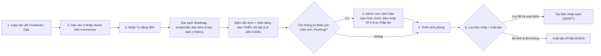

# Sprint 5 — Nhập liệu Thông minh từ Bài đăng Mạng xã hội (Auto-Parse Facebook/Zalo) & Tối ưu Quy trình Đăng tin Admin

## 1. Thông tin sprint

| Hạng mục | Nội dung |
| :--- | :--- |
| **Tên sprint** | Sprint 5 — Tự động bóc tách & nhập liệu bài đăng Facebook/Zalo (`Quick Import`) và chuẩn hóa quy trình tạo bản nháp nhanh |
| **Thời gian đề xuất** | 1 tuần (5 ngày làm việc) |
| **Bối cảnh phát sinh** | Hậu Go-Live Production (sau Sprint 4), hệ thống đã chạy ổn định trên tên miền thật (`www.phongtrobinhthanh.id.vn` và `admin.phongtrobinhthanh.id.vn`). Qua vận hành thực tế, chủ dự án phát sinh nhu cầu tối ưu thao tác đăng bài cho Admin từ thói quen viết bài đăng Facebook/Zalo. |
| **Mục tiêu chính** | Xây dựng công cụ **Nhập nhanh từ bài đăng Facebook/Zalo (`Quick Import Parser`)** ngay trong trang Tạo tin phòng (`/rooms/new`), cho phép dán 1 đoạn bài viết thô $\rightarrow$ **tự động xóa sạch toàn bộ thông tin dư thừa (`#hashtag`, nhãn dán/emoji)**, bóc tách và điền sẵn các trường nhận diện được trong `< 50 ms` (**chi phí 0đ, chạy hoàn toàn thuần JS trên trình duyệt**), đồng thời **hiển thị cảnh báo nổi bật ra màn hình chính & tô viền ngay tại các ô còn thiếu** (như `Diện tích m²`, `Phường`, `Ảnh phòng`...) để Admin tự nhập tay bổ sung đầy đủ rồi **sau đó mới tạo Bản nháp (`DRAFT`)** hoặc Xuất bản. |
| **Thành phần tác động** | Trọng tâm tại **Admin Web (`admin/`)** (`admin/src/lib/facebookPostParser.js`, `admin/src/App.jsx`, `admin/src/App.css`); giữ nguyên toàn vẹn hợp đồng dữ liệu và kiểm tra an toàn của Backend (`server/src/routes/admin.js`). |
| **Trạng thái Sprint 5** | **Đã hoàn thành mã nguồn & kiểm thử (`15/15` parser tests PASS, `admin` build đạt) — sẵn sàng nghiệm thu trên Admin Production** |

### 1.1. Mô tả vấn đề thực tế (Problem Statement)

1. **Thao tác nhập liệu thủ công bên Admin còn dài và tốn công sức**:
   - Biểu mẫu tạo tin (`RoomEditorPage` trong `admin/src/App.jsx`) hiện có hơn **15 trường dữ liệu & tùy chọn riêng biệt** (Tiêu đề, Mô tả chi tiết, Loại phòng, Tình trạng phòng, Giá thuê, Diện tích, Khu vực hiển thị, Phường chuẩn 2026, Quận, Địa chỉ đầy đủ, Cờ hiển thị địa chỉ, Danh sách 12 checkbox Tiện nghi, Ảnh phòng, Số điện thoại, Zalo, Cờ công khai liên hệ).
   - Trong khi đó, quy trình thực tế của chủ trọ/môi giới là **soạn sẵn 1 mẫu tin ngắn trên Facebook hoặc Zalo** để đăng nhóm tìm khách, ví dụ thực tế:
     ```text
     Chỉ☝️4tr2☝️ bancol , gần Quận 1 , Sạch sẽ thoáng 
      
     - 18 Nguyễn Cửa Vân , Bình Thạnh  
     - Mới Sạch sẽ , sẵn nội thất 
     - không chung chủ ,giờ giấc tự do , ra vào vân tay 

     Lh 0947832801 Toàn để xem phòng sớm nhất ạ

     #phongtrobinhthanh
     #phongtrogiare
     #phongtrobinhthanhgiare
     #phongtrosinhviengiare
     #phongtrosinhvien
     ```
   - Việc phải copy-paste rời từng mảnh thông tin, tự đổi `4tr2` thành `4200000`, tự đọc lại xem cần tick ô tiện nghi nào (`Ban công`, `Cửa sổ`, `Giường`...), tự gõ lại SĐT và chọn lại Phường khiến mỗi lần tạo 1 tin mất nhiều phút và dễ chán nản khi cần đăng nhiều phòng liên tiếp.
2. **Khoảng cách giữa bài viết Facebook thô và dữ liệu chuẩn hệ thống**:
   - Bài Facebook thường chứa **emoji** (`☝️`, `🔥`, `✨`), **từ viết tắt/sai chính tả phổ biến** (`bancol`, `4tr2`, `Lh`, `wc riêng`, `ml`, `full nt`), **hashtag** (`#phongtrobinhthanh`...), và đôi khi **thiếu một vài thông tin bắt buộc khi xuất bản** (như diện tích `areaM2` hoặc tên phường theo phân chia 5 phường Bình Thạnh 2026).

### 1.2. Sprint Goal

> Kết thúc Sprint 5, chủ dự án chỉ cần **dán nguyên văn bài đăng Facebook/Zalo** vào một ô duy nhất tại trang **Tạo tin phòng (`/rooms/new`)** và nhấn **"Tự động điền thông tin"**. Hệ thống tự động **xóa sạch hashtag, nhãn dán/emoji dư thừa**, bóc tách và điền sẵn các trường khớp được; đồng thời **thông báo thật rõ ràng trên màn hình chính và đánh dấu viền nổi bật ngay tại từng ô còn thiếu** (như `Diện tích m²`, `Phường`...) để Admin nhìn thấy ngay, **tự nhập tay bổ sung đầy đủ + thêm ảnh phòng, sau đó mới tạo thành Bản nháp (`DRAFT`)** hoàn chỉnh.

---

## 2. Nền tảng Cải tiến Hậu Go-Live (Trước khi bắt đầu Sprint 5)

Trước khi triển khai tính năng Auto-Parse của Sprint 5, hệ thống đã được cập nhật đồng bộ các cải tiến vận hành thực tế sau Sprint 4:

| Hạng mục đã hoàn thành | Mô tả cập nhật mới | Tệp liên quan |
| :--- | :--- | :--- |
| **Hỗ trợ đa tên miền (`.id.vn` + `.vercel.app`)** | Cho phép `CLIENT_ORIGIN` và `ADMIN_ORIGIN` khai báo nhiều URL cách nhau bằng dấu phẩy, hỗ trợ chạy song song `https://admin.phongtrobinhthanh.id.vn` và `https://www.phongtrobinhthanh.id.vn` mà vẫn giữ khóa `requireSameOrigin`. | `server/src/config/env.js`, `server/src/server.js`, `server/src/middleware/admin-auth.js` |
| **Liên kết trang khách tự động trên Admin** | Nút **"Xem trang khách"** và **"← Mở trang khách xem phòng"** tự động trỏ đúng sang `https://www.phongtrobinhthanh.id.vn` (khi vào qua domain `.id.vn`) hoặc `.vercel.app`. | `admin/src/branding.js` |
| **Tinh gọn chữ phụ rườm rà (Admin & Client)** | Loại bỏ các eyebrow, dòng gợi ý nhỏ (`.field-hint`, `.help-card`, `.tip-card`), ghi chú trùng lặp trên giao diện Admin và Client để dễ nhìn hơn. | `admin/src/App.jsx`, `admin/src/App.css`, `client/src/App.jsx`, `client/src/App.css` |
| **Lưới 4 bài/khung hình trên Mobile Client** | Chuyển `.public-room-grid` ở `@media (max-width: 767px)` sang **2 cột × 2 hàng** (`16/10` thumbnail, giá + diện tích 1 dòng, tiêu đề 2 dòng, địa chỉ 1 dòng, chạm toàn thẻ) để khách xem 4 phòng trên 1 khung điện thoại mà không phải cuộn từng bài. | `client/src/App.css` |

---

## 3. Phạm vi Sprint 5

### 3.1. Trong phạm vi

1. **Bộ phân tích văn bản tiếng Việt thuần JS (`admin/src/lib/facebookPostParser.js`)**:
   - Không phụ thuộc LLM bên ngoài hay API mất phí (`0đ`, độ trễ `< 50 ms`, hoạt động cả offline).
   - Bóc tách chính xác 10 nhóm dữ liệu khớp 100% schema `emptyListing` trong `admin/src/App.jsx` và `editableListingSchema` trong `server/src/routes/admin.js`.
2. **Giao diện "Nhập nhanh từ bài đăng Facebook / Zalo" (`admin/src/App.jsx`, `admin/src/App.css`)**:
   - Đặt ngay đầu trang **Tạo tin phòng (`/rooms/new`)** (và cho phép mở rộng/thu gọn gọn gàng khi chỉnh sửa tin nháp).
   - **Tự động lọc sạch thông tin dư thừa mặc định**: xóa toàn bộ `#hashtag` (ở mọi vị trí trong bài) và mọi nhãn dán/emoji trang trí (`☝️`, `🔥`, `✨`, `✅`...) khỏi `title`, `description`, `publicAddress`; báo rõ số hashtag/nhãn dán đã dọn sạch.
   - **Cảnh báo thiếu thông tin nổi bật trên màn hình chính & từng ô**: hiển thị bảng nhắc việc màu hổ phách ngay đầu màn hình chính liệt kê từng trường còn thiếu (có nút bấm để **cuộn & nhảy thẳng vào ô thiếu**), đồng thời gắn viền cảnh báo + nhãn `"Thiếu thông tin — vui lòng nhập tay"` trực tiếp trên các ô đó (`Diện tích m²`, `Phường`, `Ảnh phòng`...) cho tới khi Admin tự nhập xong.
   - **An toàn dữ liệu đang nhập (`Safe Merge`)**: Khi người dùng đã gõ tay một số ô trước đó, hệ thống mặc định chỉ điền vào ô còn trống (hoặc cho phép tích chọn `"Ghi đè các ô đã có dữ liệu"`).
3. **Từ điển chuẩn hóa đặc thù Quận Bình Thạnh 2026 & Từ khóa phòng trọ**:
   - Từ điển ánh xạ **20 phường cũ Bình Thạnh $\rightarrow$ 5 phường mới 2026** (`1685/NQ-UBTVQH15`).
   - Từ điển **tên đường phổ biến ở Quận Bình Thạnh $\rightarrow$ Phường 2026 gợi ý** (xử lý được các trường hợp gõ thiếu dấu hoặc biến thể phổ biến như `Nguyễn Cửa Vân` / `Nguyễn Cửu Vân`).
   - Từ điển đồng nghĩa & teencode cho toàn bộ **12 tiện nghi chuẩn (`AMENITIES`)** và **5 loại phòng (`ROOM_TYPES`)**.
4. **Quy trình kiểm tra đủ thông tin rồi mới tạo Bản nháp (`Guided Pre-Draft Workflow`)**:
   - Sau khi tự động điền, Admin nhìn danh sách cảnh báo trên màn hình chính để **nhập tay bổ sung các thông tin bị thiếu** (như `Diện tích m²`, `Phường` nếu bài gốc không ghi) và kéo thả ảnh phòng; hệ thống nhắc rõ và cuộn tới ô thiếu đầu tiên nếu Admin bấm **"Lưu bản nháp"** khi các trường thông tin thiếu từ Quick Import vẫn chưa được bổ sung, đảm bảo bản nháp tạo ra qua `POST /api/v1/admin/rooms` luôn đầy đủ và sạch sẽ.
5. **Bộ kiểm thử tự động cho Parser (`AT-501` – `AT-508`)**:
   - Kiểm thử với ít nhất `15` mẫu bài đăng Facebook/Zalo thực tế đa dạng định dạng.

### 3.2. Ngoài phạm vi Sprint 5

| Hạng mục | Lý do giữ ngoài phạm vi |
| :--- | :--- |
| Dán link bài viết Facebook (`https://facebook.com/...`) để tự tải chữ & ảnh | Meta/Facebook chặn crawl công khai và yêu cầu Cookie/Graph API doanh nghiệp; giữ dán text trực tiếp giúp hệ thống ổn định, 0đ và không vi phạm chính sách. |
| Tích hợp AI LLM bên thứ ba (OpenAI / Gemini API) | Chưa cần thiết khi bộ parser + từ điển Bình Thạnh xử lý chính xác bài đăng tiếng Việt miễn phí; có thể nâng cấp làm fallback ở giai đoạn sau nếu cần. |
| Tạo nhiều phòng từ một bài tổng hợp 5–10 phòng khác nhau | Mỗi tin trên website tương ứng 1 phòng/loại phòng độc lập; bài tổng hợp nhiều giá sẽ được trích mức giá đầu tiên và cảnh báo admin tách tin. |

---

## 4. Thiết kế Luồng UX & Kiến trúc Kỹ thuật Chi tiết

### 4.1. Sơ đồ luồng thao tác mới cho Admin (`/rooms/new`)



### 4.2. Đặc tả chi tiết Thuật toán Bóc tách (`admin/src/lib/facebookPostParser.js`)

Hàm chính `parseRoomPostText(rawText)` xử lý tuần tự theo **6 bước chuẩn hóa** và trả về `{ fields, matchedSummary, removedNoise, missingFields, warnings }`:

#### Bước 1: Tiền xử lý & Xóa sạch thông tin dư thừa (`removedNoise`)
- **Xóa triệt để toàn bộ `#hashtag`**: loại bỏ mọi cụm `#\S+` ở bất kỳ vị trí nào (cuối bài hay xen giữa câu, ví dụ `#phongtrobinhthanh`, `#phongtrogiare`...) và đếm số hashtag đã xóa (`removedNoise.hashtagsCount`).
- **Xóa triệt để toàn bộ nhãn dán, sticker & emoji**: lọc sạch các ký tự Unicode Emoji / Symbol (`\p{Extended_Pictographic}`, `\uFE0F`, `\u200D`, `☝️`, `🔥`, `✨`, `✅`, `👉`, `📌`...) và các cụm kêu gọi rác/ký tự lặp thừa (như `----`, `====`, nhiều dấu chấm/khoảng trắng liên tiếp), đếm số nhãn dán/emoji đã loại (`removedNoise.emojisCount`).
- Giữ bản văn bản sạch dòng để tạo `description` và chuẩn hóa các dòng có dấu gạch đầu dòng (`-`, `•`, `+`, `*`) cho mạch lạc.

#### Bước 2: Bóc tách Giá thuê (`priceVnd`)
Hỗ trợ mọi cách viết giá thuê phòng tại Việt Nam (ưu tiên khớp từ trên xuống, **bỏ qua số đi sau chữ `"cọc"`, `"điện"`, `"nước"`, `"xe"`, `"rác"`, `"wifi"`** để tránh nhận nhầm tiền cọc hoặc phí dịch vụ):

| Cách viết trên Facebook | Chuỗi nhận diện (Regex mẫu) | Kết quả `priceVnd` |
| :--- | :--- | :---: |
| `4tr2`, `4tr 2`, `4.2tr`, `4,2 triệu` | `(\d+)\s*(?:tr\|triệu)\s*(\d{1,2})?` hoặc `(\d+[.,]\d+)\s*(?:tr\|triệu)` | `4200000` |
| `4tr`, `4 triệu`, `5 củ` | `(\d+)\s*(?:tr\|triệu\|củ)` | `4000000` / `5000000` |
| `4.200.000`, `4,200,000đ`, `4200000` | `(\d{1,2}[.,]\d{3}[.,]\d{3})` | `4200000` |
| `4200k`, `3800k/tháng` | `(\d{3,4})\s*k` | `4200000` / `3800000` |

- Kiểm tra ngưỡng hợp lệ: chỉ nhận giá trong khoảng `500.000` đến `50.000.000` VNĐ để tránh nhầm số nhà hay năm sinh. Nếu phát hiện khoảng giá (ví dụ `"4tr2 - 4tr5"`), chọn `4200000` và thêm cảnh báo `"Bài viết ghi khoảng giá, hệ thống tạm chọn mức thấp nhất (4.200.000 ₫)."`

#### Bước 3: Bóc tách Diện tích (`areaM2`) & Tổng hợp Danh sách Thông tin Thiếu (`missingFields`)
- Mẫu khớp: `(\d+(?:[.,]\d+)?)\s*(?:m2|m²|met vuong|mét vuông)\b` (không nhận diện nhầm `m` đơn lẻ).
- Kiểm tra ngưỡng hợp lệ: `5 <= areaM2 <= 500`.
- **Đối soát đủ điều kiện sau Auto-Parse**: Sau khi chạy xong 6 bước, kiểm tra ngay tất cả các trường thiết yếu (`title`, `description`, `roomType`, `priceVnd`, `areaM2`, `publicAddress`, `ward`, `contactPhone`/`contactZalo`). Bất kỳ trường nào chưa bóc tách được (ví dụ bài mẫu không có **`areaM2` — Diện tích**) được đưa vào mảng `missingFields` (kèm `fieldId`, nhãn tiếng Việt, lý do thiếu) để **hiện cảnh báo nổi bật ra màn hình chính và đánh dấu viền ngay tại ô input đó** cho Admin tự nhập tay trước khi tạo bản nháp.

#### Bước 4: Bóc tách Số điện thoại & Zalo (`contactPhone`, `contactZalo`)
- Chuẩn hóa các dạng số ngăn cách bằng dấu `.`, `-`, khoảng trắng: `(?:0|\+84)\s*[35789](?:[\s.\-]*\d){8}`.
- Chuyển `+84xxxxxxxxx` thành `0xxxxxxxxx`, lọc bỏ ký tự phân cách $\rightarrow$ ví dụ `Lh 0947832801 Toàn` cho ra `"0947832801"`.
- Mặc định: điền cả `contactPhone` và `contactZalo` bằng SĐT tìm được đầu tiên, tự động bật `allowPublicPhone: true` và `allowPublicZalo: true` (nếu trong bài có link `https://zalo.me/...` thì ưu tiên lấy link Zalo đó).

#### Bước 5: Bóc tách Địa chỉ & Ánh xạ Phường Bình Thạnh 2026 (`privateAddress`, `publicAddress`, `ward`)
1. **Nhận diện dòng địa chỉ**:
   - Tìm dòng chứa chỉ dấu địa chỉ (`Đ/c`, `Địa chỉ`, `Số`, `Hẻm`, `Đường`, tên đường Bình Thạnh, hoặc cụm có dấu phẩy kết hợp `"Bình Thạnh"`, `"P."`, `"Phường"`).
   - Chuẩn hóa các lỗi chính tả nhẹ phổ biến qua từ điển sửa tên đường (ví dụ: `"Nguyễn Cửa Vân"` $\rightarrow$ `"Nguyễn Cửu Vân"`, kèm giữ nguyên hoặc hiển thị ghi chú nhẹ nếu hệ thống tự chỉnh chính tả để admin kiểm tra lại).
   - Gán chuỗi địa chỉ cụ thể (có số nhà, ví dụ `"18 Nguyễn Cửu Vân, Bình Thạnh"`) vào `privateAddress`, **luôn giữ `allowExactAddress: false`** theo đúng nguyên tắc bảo mật địa chỉ của hệ thống (`RULE-05`).
   - Tự sinh `publicAddress` an toàn (loại bỏ số nhà cụ thể ở đầu, giữ tên đường + điểm mốc nếu có trong bài, ví dụ `"Đường Nguyễn Cửu Vân, gần Quận 1"`).
2. **Nhận diện & Ánh xạ Phường (`ward` thuộc `BINH_THANH_WARDS`)**:
   - **Ưu tiên 1 — Khớp trực tiếp 5 phường mới 2026**: `Phường Gia Định`, `Phường Bình Thạnh`, `Phường Bình Lợi Trung`, `Phường Thạnh Mỹ Tây`, `Phường Bình Quới`.
   - **Ưu tiên 2 — Ánh xạ 20 phường cũ sang 5 phường mới 2026** (nếu bài Facebook vẫn ghi `P.17`, `Phường 25`...):
     - Ví dụ tra cứu từ bảng ánh xạ chuẩn Nghị quyết `1685/NQ-UBTVQH15`: `Phường 17` $\rightarrow$ `Phường Gia Định`; `Phường 25` $\rightarrow$ `Phường Thạnh Mỹ Tây`; `Phường 26` $\rightarrow$ `Phường Bình Thạnh`...
   - **Ưu tiên 3 — Gợi ý theo Từ điển Tên đường Bình Thạnh**:
     - Các tuyến đường ngắn nằm gọn trong 1 phường mới (ví dụ: `Nguyễn Cửu Vân`, `Trần Văn Kỷ`, `Vũ Huy Tấn` $\rightarrow$ gợi ý `Phường Gia Định`; `Nguyễn Gia Trí (D2)`, `Võ Oanh (D3)`, `Nguyễn Hữu Cảnh` $\rightarrow$ `Phường Thạnh Mỹ Tây`...).
     - Với các trục đường dài đi qua nhiều phường (như `Xô Viết Nghệ Tĩnh`, `Điện Biên Phủ`, `Phan Văn Trị`, `Lê Quang Định`), **không tự chốt cứng** nếu không có số nhà/phường, mà thêm nhắc nhở `"Vui lòng chọn xác nhận Phường (tuyến đường đi qua nhiều phường)."`

#### Bước 6: Bóc tách Loại phòng (`roomType`), Tiện nghi (`amenities[]`), Tiêu đề (`title`) & Mô tả (`description`)

1. **Bảng từ điển Ánh xạ 12 Tiện nghi chuẩn (`AMENITIES`)**:

| Tiện nghi chuẩn hệ thống | Từ khóa nhận diện (không phân biệt hoa/thường & biến thể teencode) |
| :--- | :--- |
| `Máy lạnh` | `máy lạnh`, `may lanh`, `điều hòa`, `dieu hoa`, `ml` *(khi đi cùng danh sách nội thất)* |
| `Tủ lạnh` | `tủ lạnh`, `tu lanh`, `tủ mát` |
| `Thang máy` | `thang máy`, `thang may`, `có thang` |
| `Giường` | `giường`, `giuong`, `nệm`, `sẵn nội thất`, `full nội thất`, `đầy đủ nội thất` |
| `Tủ quần áo` | `tủ quần áo`, `tủ đồ`, `tủ áo`, `full nội thất`, `sẵn nội thất` |
| `Bếp riêng` | `bếp riêng`, `kệ bếp`, `bếp nấu`, `tủ bếp`, `bep rieng` |
| `Nhà vệ sinh riêng` | `nhà vệ sinh riêng`, `vệ sinh riêng`, `wc riêng`, `tolet riêng`, `toilet riêng`, `nvs riêng`, `khép kín` |
| `Ban công` | `ban công`, `bancol`, `bancon`, `ban cong`, `balcony` |
| `Gác lửng` | `gác lửng`, `có gác`, `gác cao`, `phòng gác`, `gac lung` |
| `Wifi` | `wifi`, `wi-fi`, `internet`, `mạng mạnh` |
| `Chỗ để xe` | `chỗ để xe`, `để xe`, `bãi xe`, `nhà xe`, `hầm xe`, `giữ xe` |
| `Cửa sổ` | `cửa sổ`, `cua so`, `thoáng mát`, `sạch sẽ thoáng`, `nhiều sáng`, `giếng trời` |

2. **Bảng suy luận Loại phòng (`ROOM_TYPES`)**:
   - Có `studio` $\rightarrow$ `"Phòng studio"`
   - Có `căn hộ mini`, `chdv`, `căn hộ dịch vụ` $\rightarrow$ `"Căn hộ mini"`
   - Có `ở ghép`, `tìm bạn ở cùng` $\rightarrow$ `"Phòng ở ghép"`
   - Có `gác`, `có gác`, `gác lửng` $\rightarrow$ `"Phòng có gác"`
   - Mặc định $\rightarrow$ `"Phòng trọ"`

3. **Sinh `title` & làm sạch `description`**:
   - **`title`**: Tạo tiêu đề tự nhiên theo công thức:
     `[Loại phòng] + [Điểm nổi bật ngắn: Ban công / Nội thất / Thoáng...] + [Đoạn mốc: gần Quận 1 / tên đường]`, **xóa toàn bộ emoji/nhãn dán và hashtag**, viết hoa chữ cái đầu, cắt gọn không đứt từ tối đa `120` ký tự (tuân thủ giới hạn `10–120` ký tự khi xuất bản).
   - **`description`**: Giữ lại toàn bộ các ý quan trọng của bài gốc (đặc biệt các thông tin giá trị như `"không chung chủ, giờ giấc tự do, ra vào vân tay"`), **tự động xóa bỏ 100% các `#hashtag`, nhãn dán/emoji (`☝️`, `🔥`...) và khoảng trắng/dấu câu thừa** để nội dung hiển thị cho khách gọn gàng, lịch sự.

---

## 5. Minh họa Kết quả Chuyển đổi Thực tế (`AT-501` — Mẫu bài của Chủ dự án)

Khi dán nguyên văn bài mẫu Facebook của bạn vào khung **Nhập nhanh**, hệ thống tự động dọn sạch `5` hashtag + `2` nhãn dán `☝️`, đồng thời điền và cảnh báo ngay trên màn hình chính như sau:

| Trường dữ liệu trên Admin | Giá trị tự động điền từ bài mẫu | Trạng thái trên màn hình |
| :--- | :--- | :---: |
| **`title`** (Tiêu đề tin) | `Phòng trọ có ban công gần Quận 1, đường Nguyễn Cửu Vân, Bình Thạnh` | Tự điền (đã xóa `☝️`) |
| **`description`** (Mô tả chi tiết) | `Phòng có ban công, gần Quận 1, sạch sẽ thoáng.`<br>`- Khu vực: 18 Nguyễn Cửu Vân, Bình Thạnh`<br>`- Mới sạch sẽ, sẵn nội thất`<br>`- Không chung chủ, giờ giấc tự do, ra vào vân tay` | Tự điền (đã xóa `#hashtag` & `☝️`) |
| **`roomType`** (Loại phòng) | `Phòng trọ` | Tự điền |
| **`priceVnd`** (Giá thuê) | `4200000` (`4.200.000 ₫ / tháng`) | Tự điền (`4tr2`) |
| **`areaM2`** (Diện tích) | *(Trống — `null`)* | **Cảnh báo ĐỎ/CAM ngay trên màn hình chính + tô viền ô Diện tích yêu cầu Admin nhập tay** |
| **`publicAddress`** | `Đường Nguyễn Cửu Vân, gần Quận 1` *(hoặc khu vực đường tương ứng)* | Tự điền |
| **`ward`** (Phường 2026) | `Phường Gia Định` *(gợi ý từ tuyến Nguyễn Cửu Vân)* | Tự gợi ý (có nhắc kiểm tra lại) |
| **`privateAddress`** | `18 Nguyễn Cửu Vân, Bình Thạnh` (`allowExactAddress = false`) | Tự điền (giữ riêng tư) |
| **`amenities[]`** | `["Ban công", "Giường", "Tủ quần áo", "Cửa sổ"]` | Tự tick (`bancol`, `sẵn nội thất`, `thoáng`) |
| **`contactPhone` & `contactZalo`** | `0947832801` (`allowPublicPhone = true`, `allowPublicZalo = true`) | Tự điền (`Lh 0947832801`) |
| **`images[]`** | *(Chưa có)* | **Nhắc thêm ảnh phòng trước khi xuất bản** |

> **Kết quả vận hành**: Hệ thống xử lý hết phần rập khuôn & xóa sạch rác (`#hashtag`, emoji `☝️`), chỉ ra chính xác ô còn thiếu (`Diện tích m²`) ngay trên màn hình để Admin tự nhập tay trong 3 giây, thêm ảnh rồi bấm **Lưu bản nháp** (hoặc **Xuất bản**).

---

## 6. Thiết kế Giao diện & Trải nghiệm Người dùng Mới (`admin/src/App.jsx` & `admin/src/App.css`)

### 6.1. Khối "Nhập nhanh từ bài đăng Facebook / Zalo" & Bảng Cảnh báo Thiếu Thông tin trên Màn hình Chính

- **Vị trí hiển thị**: Ngay đầu cột chính `.form-main-column` (phía trên mục `01 Thông tin phòng`) khi đang ở `/rooms/new`. Ở màn hình chỉnh sửa (`/rooms/:roomId`), mặc định thu gọn thành 1 thanh nhỏ `"Dán nội dung khác để điền nhanh"` để giữ giao diện sạch sẽ như đã tinh gọn trước đó.
- **Thành phần UI tối giản, đồng bộ thiết kế hiện tại**:
  - Tiêu đề gọn: `Nhập nhanh từ bài đăng Facebook / Zalo`
  - Ô `textarea` 5 dòng (`Dán toàn bộ bài viết (giá, địa chỉ, tiện nghi, SĐT...) vào đây...`).
  - Hàng thao tác bên dưới:
    - Nút chính: `Tự động điền thông tin` (`button-primary button-small`)
    - Nút phụ: `Xóa ô dán` (`button-secondary button-small`)
    - Tùy chọn nhỏ gọn: Checkbox `Ghi đè các ô đã nhập` (mặc định bật khi toàn bộ form đang trống, tắt khi người dùng đã sửa tay). Toàn bộ `#hashtag` và nhãn dán/emoji dư thừa được **tự động xóa sạch mặc định**.
- **Hiển thị rõ ràng thông tin đã dọn, đã điền và THÔNG TIN CÒN THIẾU ra màn hình chính**:
  1. **Thanh thông báo tóm tắt dọn rác & tự điền (`.quick-import-summary`)**:
     - Hiển thị rõ số trường đã tự điền và số rác đã xóa, ví dụ: `"Đã xóa 5 hashtag & 2 nhãn dán/emoji · Đã tự điền 8 mục (Tiêu đề, Mô tả, Giá, Địa chỉ, Phường, 4 tiện nghi, SĐT/Zalo)."`
  2. **Hộp cảnh báo THIẾU THÔNG TIN nổi bật ngay trên màn hình chính (`.quick-import-missing-alert`)**:
     - Khi còn bất kỳ trường thông tin thiết yếu nào bị thiếu (như `Diện tích (m²)`, `Phường`, `Giá thuê`, `SĐT/Zalo`...), hộp cảnh báo màu cam/hổ phách nổi bật xuất hiện ngay đầu màn hình chính (và tự cập nhật real-time: mục nào Admin vừa gõ tay xong sẽ tự biến mất khỏi danh sách thiếu!):
       - Tiêu đề rõ ràng: **`⚠ Cần bạn tự nhập tay bổ sung trước khi tạo bản nháp:`**
       - Liệt kê các nút/chip bấm nhanh cho từng trường thiếu (ví dụ nút `[Điền ngay: Diện tích (m²)]`, `[Chọn: Phường]`): **bấm vào nút nào sẽ tự cuộn mượt và đặt con trỏ thẳng vào đúng ô input đó**.
  3. **Tô viền & gắn nhãn trực tiếp ngay tại ô còn thiếu (`Inline Missing Highlight`)**:
     - Chính bản thân ô đang thiếu (ví dụ `#field-areaM2`) được gắn class `.is-missing-import` (viền cam nổi bật + nền nhạt nhẹ) kèm dòng nhắc ngắn ngay bên dưới: `"Bài viết chưa có thông tin này — vui lòng tự nhập tay."`.
  4. **Chốt kiểm tra trước khi bấm "Lưu bản nháp" (Pre-Draft Check)**:
     - Sau khi đã kích hoạt Tự động điền, nếu vẫn còn trường thiếu trong `missingFields` (ví dụ chưa tự nhập tay `Diện tích m²`) mà Admin bấm **"Lưu bản nháp"**, giao diện sẽ **hiển thị thông báo nhắc ngay trên màn hình chính và tự cuộn/focus thẳng vào ô còn thiếu đầu tiên** để Admin nhập tay xong rồi mới tạo thành Bản nháp (`DRAFT`) hoàn chỉnh.

### 6.2. Cải tiến tương thích Mobile Admin

Do chủ trọ thường copy tin trên điện thoại (Zalo/Facebook) rồi dán thẳng vào trang Admin `https://admin.phongtrobinhthanh.id.vn` trên điện thoại:
- Khối `.quick-import-card` tối ưu cho màn hình `<= 767px`: nút **"Tự động điền thông tin"** rộng full-width dễ bấm bằng ngón tay (`min-height: 44px`), cho phép dán nhanh bằng nút **"Dán từ clipboard"** (`navigator.clipboard.readText()` có fallback thông báo nhẹ nếu trình duyệt chặn quyền clipboard).

---

## 7. Product Backlog Sprint 5

| Mã | Hạng mục | Mô tả kỹ thuật & Tệp liên quan | Tiêu chí hoàn tất (Acceptance Criteria) |
| :---: | :--- | :--- | :--- |
| `S5-01` | Xây dựng Từ điển Bình Thạnh 2026 & Từ điển Tiện nghi | Tạo bảng ánh xạ 20 phường cũ $\rightarrow$ 5 phường mới 2026, danh sách tuyến đường đặc trưng Bình Thạnh (kèm sửa lỗi chính tả hay gặp như `Nguyễn Cửa Vân` $\rightarrow$ `Nguyễn Cửu Vân`), bảng từ khóa 12 `AMENITIES` & 5 `ROOM_TYPES` trong `admin/src/lib/facebookPostParser.js`. | Ánh xạ đúng 100% 5 phường mới 2026; đường xuyên nhiều phường không đoán sai bừa; nhận diện đúng các teencode phổ biến (`bancol`, `wc riêng`, `ml`, `full nt`, `gác`). |
| `S5-02` | Triển khai Thuật toán Parser `parseRoomPostText()` | Viết module pure-JS xóa sạch toàn bộ `#hashtag`, nhãn dán/emoji (`removedNoise`), bóc tách giá (`4tr2`, `4.2tr`, `4.200.000`, `4200k`, bỏ qua giá cọc/điện nước), diện tích (`20m2`, `20 m²`), SĐT/Zalo, địa chỉ nội bộ/công khai, tự sinh `title` sạch, `description` sạch và liệt kê `missingFields`. | Thời gian xử lý `< 50 ms`; 0 hashtag & 0 nhãn dán lọt vào `title`/`description`; trả chính xác `missingFields` khi thiếu trường thiết yếu; không tự bật `allowExactAddress`. |
| `S5-03` | Tích hợp UI Khối Nhập nhanh & Cảnh báo Thiếu Thông tin trên Màn hình Chính | Cập nhật `admin/src/App.jsx` và `admin/src/App.css`: thêm `.quick-import-card` ở `/rooms/new`, nút `Dán từ bộ nhớ tạm`, `Tự động điền thông tin`, hộp `.quick-import-missing-alert` có nút **click-to-focus nhảy thẳng tới ô thiếu**, và viền `.is-missing-import` + nhãn `"vui lòng nhập tay"` ngay tại từng ô thiếu. | Giao diện rõ ràng trên cả Desktop & Mobile (`360px`–`430px`); Admin thấy ngay trường bị thiếu (`Diện tích m²`...) trên màn hình chính; ngay khi Admin nhập tay xong, cảnh báo ở ô đó tự biến mất. |
| `S5-04` | Chốt kiểm tra Pre-Draft trước khi Tạo Bản nháp từ Auto-Parse | Khi sử dụng Quick Import, nếu `missingFields` vẫn còn trường chưa nhập (vd `areaM2`, `ward`...), bấm **"Lưu bản nháp"** sẽ nhắc rõ trên màn hình chính và tự cuộn/focus vào ô thiếu đầu tiên để Admin nhập tay xong rồi mới tạo Bản nháp (`DRAFT`). | Admin bổ sung xong trường thiếu + ảnh $\rightarrow$ `POST /api/v1/admin/rooms` tạo bản nháp hoàn chỉnh (`201`); nút Xuất bản giữ nguyên validation `AT-09` (bắt buộc có ảnh bìa & đủ mọi trường). |
| `S5-05` | Bộ Kiểm thử Tự động Parser (`verify-sprint5-parser`) | Viết script kiểm thử (ví dụ `admin/scripts/verify-parser.mjs` hoặc `npm --prefix admin run test:parser`) với **15+ ca test thực tế** gồm bài mẫu của chủ dự án, bài nhiều emoji/hashtag, bài teencode, bài thiếu giá/diện tích, bài nhiều SĐT, bài có giá cọc. | 100% ca test PASS (`exit 0`); kiểm tra cả trường hợp xóa sạch hashtag/nhãn dán lẫn trả đúng `missingFields`. |
| `S5-06` | Nghiệm thu Thực tế trên Production Admin & Bàn giao | Deploy lên Vercel (`admin.phongtrobinhthanh.id.vn`), chủ dự án dán thử 3–5 bài đăng Facebook thật, nhập tay các mục thiếu theo cảnh báo, thêm ảnh Cloudinary, tạo bản nháp và xuất bản xem trên trang khách (`www.phongtrobinhthanh.id.vn`). | Thời gian nhập 1 tin mới (không tính khâu chụp ảnh) giảm xuống **< 20 giây**; dữ liệu hiển thị sạch đẹp trên trang khách mobile 4 thẻ/khung và desktop. |

---

## 8. Ma trận Kiểm thử & Nghiệm thu Sprint 5 (`AT-501` – `AT-508`)

| Mã AT | Kịch bản kiểm thử | Đầu vào mẫu | Kết quả kỳ vọng |
| :---: | :--- | :--- | :--- |
| **`AT-501`** | **Xóa rác & Bóc tách Bài mẫu thực tế của Chủ dự án** | Bài `"Chỉ☝️4tr2☝️ bancol , gần Quận 1 ... 18 Nguyễn Cửa Vân , Bình Thạnh ... Lh 0947832801 Toàn ... #phongtrobinhthanh"` | Xóa sạch `5` hashtag & `2` nhãn dán `☝️` khỏi `title`/`description`; `priceVnd = 4200000`, `amenities` có `Ban công`, `Cửa sổ`, `Giường`, `Tủ quần áo`; `contactPhone = "0947832801"`, `contactZalo = "0947832801"`, `privateAddress` chứa `"18 Nguyễn Cửa Vân, Bình Thạnh"` (`allowExactAddress = false`), `ward` gợi ý `Phường Gia Định`; **màn hình chính hiện bảng cảnh báo thiếu `Diện tích (m²)` và tô viền cam tại `#field-areaM2`**. |
| **`AT-502`** | **Đa dạng cách ghi Giá thuê & Loại trừ tiền cọc** | `"Giá 3.5tr/tháng, cọc 1tr, điện 4k"` và `"4200k/tháng"` | Khớp đúng `3500000` (không nhầm `1000000` tiền cọc hay `4000` tiền điện) và `4200000`. |
| **`AT-503`** | **Nhận diện Diện tích & Loại phòng** | `"Phòng có gác lửng 22.5 m2"` và `"CHDV studio 28m²"` | `roomType = "Phòng có gác"`, `areaM2 = 22.5`, tick `"Gác lửng"`; với bài 2: `roomType = "Phòng studio"` (hoặc `"Căn hộ mini"`), `areaM2 = 28`; `missingFields` không báo thiếu `areaM2`. |
| **`AT-504`** | **Ánh xạ Phường cũ sang 5 Phường Bình Thạnh 2026** | `"120 Võ Oanh, P.25, Bình Thạnh"` và `"Hẻm 80 Nơ Trang Long, P.14"` | Tự động chuyển `P.25` $\rightarrow$ `Phường Thạnh Mỹ Tây`, `P.14` $\rightarrow$ `Phường Bình Thạnh`. |
| **`AT-505`** | **Bảo vệ dữ liệu đang nhập (`Safe Merge`)** | Admin đã nhập tay `priceVnd = 4500000`, sau đó dán bài `"4tr2..."` khi tắt checkbox `"Ghi đè"` | `priceVnd` giữ nguyên `4500000`, chỉ các ô còn trống được điền từ bài dán; khi bật `"Ghi đè"` mới thay thế. |
| **`AT-506`** | **Thông báo màn hình chính & Chốt nhập tay trước khi Tạo Bản nháp** | Dán bài mẫu (thiếu `areaM2`), chưa nhập diện tích mà bấm **"Lưu bản nháp"**; sau đó bấm chip `"Điền ngay: Diện tích (m²)"`, nhập `20` và bấm **"Lưu bản nháp"** | Lần bấm 1: hiện cảnh báo rõ trên màn hình chính và tự cuộn/focus vào ô `#field-areaM2` nhắc nhập tay. Lần bấm 2 (sau khi nhập `20`): viền cam biến mất, `POST /api/v1/admin/rooms` tạo bản nháp `DRAFT` thành công (`201`). |
| **`AT-507`** | **Chặn xuất bản nếu còn thiếu ảnh hoặc trường bắt buộc** | Tin nháp đã nhập đủ chữ & `areaM2 = 20` nhưng chưa có ảnh, bấm **"Xuất bản"** | Hệ thống giữ nguyên rào kiểm tra chuẩn: báo lỗi rõ tại mục `#field-images` và không cho chuyển sang `PUBLISHED` cho tới khi Admin thêm ít nhất 1 ảnh bìa. |
| **`AT-508`** | **Kiểm thử thao tác trên Mobile thật (`admin.phongtrobinhthanh.id.vn`)** | Mở `/rooms/new` trên điện thoại (`390×844`), dán text Facebook, bấm nút tự động điền | Bảng cảnh báo thiếu & nút nhảy tới ô thiếu hiển thị rõ ràng, không tràn ngang, vùng chạm $\ge 44\text{px}$; tin xuất bản hiển thị đẹp trên lưới 4 thẻ/khung ở `www.phongtrobinhthanh.id.vn`. |

---

## 9. Rủi ro và Biện pháp Phòng ngừa

| Rủi ro | Mức độ | Biện pháp kiểm soát |
| :--- | :---: | :--- |
| **Gán sai Phường Bình Thạnh 2026** với các tuyến đường dài đi qua nhiều phường (như Xô Viết Nghệ Tĩnh, Điện Biên Phủ, Lê Quang Định) | **Trung bình** | Chỉ tự chọn `ward` khi bài viết nêu rõ tên phường (mới hoặc cũ có bảng ánh xạ 1-1) hoặc tên đường ngắn nằm trọn trong 1 phường; đường xuyên nhiều phường sẽ để trống kèm đưa vào `missingFields` để hiện cảnh báo nhắc admin chọn tay trên màn hình chính. |
| **Nhận nhầm số tiền cọc, phí dịch vụ hoặc số phòng** thành `priceVnd` | **Trung bình** | Bỏ qua số đi liền sau từ khóa `cọc`, `điện`, `nước`, `net`, `rác`, `xe`, `p.`, `phòng`; chỉ nhận số có đơn vị tiền thuê hợp lệ (`tr`, `triệu`, `k`, `đ`, `.000`) trong ngưỡng `500.000`–`50.000.000`. |
| **Dán bài làm ghi đè thông tin Admin vừa sửa tay** | **Thấp** | Bổ sung cờ `Ghi đè các ô đã có dữ liệu` và lưu giữ lịch sử ngắn trong phiên chỉnh sửa để có thể sửa lại từng ô bình thường trước khi bấm Lưu. |
| **Gõ sai tên đường trong bài Facebook** (ví dụ `Nguyễn Cửa Vân` thay vì `Nguyễn Cửu Vân`) | **Thấp** | Giữ từ điển sửa chính tả tên đường phổ biến ở Bình Thạnh hoặc thông báo nhẹ `"Đã chuẩn hóa tên đường: Nguyễn Cửu Vân"` để admin dễ kiểm chứng lại. |

---

## 10. Điều kiện Hoàn tất Sprint 5 (Definition of Done)

- [ ] Hoàn thành module `admin/src/lib/facebookPostParser.js` với đầy đủ 6 bước xóa sạch hashtag/nhãn dán, bóc tách và bộ từ điển Bình Thạnh 2026 / 12 tiện nghi.
- [ ] Tích hợp hoàn chỉnh khối **Nhập nhanh từ bài đăng Facebook / Zalo**, hộp cảnh báo thiếu nổi bật trên màn hình chính (`.quick-import-missing-alert`), tô viền inline từng ô thiếu (`.is-missing-import`) và chốt kiểm tra Pre-Draft vào `admin/src/App.jsx` & `admin/src/App.css`.
- [ ] Toàn bộ bộ kiểm thử tự động `AT-501`–`AT-508` (tối thiểu 15 mẫu bài viết Facebook đa dạng) đạt `100% PASS`.
- [ ] `npm --prefix admin run build` chạy thành công không lỗi (`exit 0`), `0` dependency AI trả phí phát sinh.
- [ ] Push lên nhánh `main` và xác nhận hoạt động ổn định trên `https://admin.phongtrobinhthanh.id.vn`.
