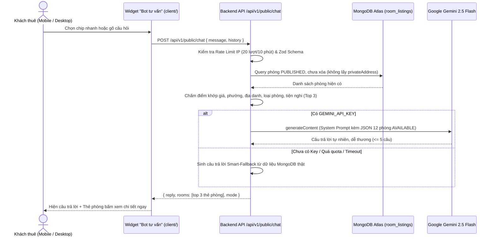

# Sprint 6 — Chatbot AI Tư vấn Khách hàng ("Bot tư vấn") Theo Dữ liệu Thực tế

## 1. Thông tin sprint

| Hạng mục | Nội dung |
| :--- | :--- |
| **Tên sprint** | Sprint 6 — Xây dựng trợ lý AI Chatbot **"Bot tư vấn"** tư vấn tìm phòng tự nhiên trên trang Khách hàng (`client/`) |
| **Thời gian đề xuất** | 1 tuần (5 ngày làm việc) |
| **Bối cảnh phát sinh** | Sau Sprint 5, khâu nhập liệu bên Admin đã tự động hóa nhanh từ bài viết Facebook/Zalo. Trên cổng Khách hàng (`www.phongtrobinhthanh.id.vn`), người tìm trọ thường dùng điện thoại và có thói quen hỏi tự nhiên theo nhu cầu (ví dụ: *"Tìm phòng dưới 4 triệu gần Hàng Xanh có ban công"*), thay vì phải tự bấm từng ô lọc. |
| **Mục tiêu chính** | Tích hợp bong bóng chat nổi **"Bot tư vấn"** phong cách thân thiện, dễ thương (mascot chibi Bo tròn hợp nhận diện **Ngọc Toàn**) nối với API `POST /api/v1/public/chat`. Bot sử dụng **Google Gemini Free Tier (`gemini-2.5-flash`) + RAG trực tiếp từ MongoDB `room_listings`** để trả lời đúng sự thật các phòng đang `AVAILABLE`, kèm thẻ phòng bấm vào xem chi tiết ngay và **Smart Fallback** miễn phí khi chưa gắn `GEMINI_API_KEY` hoặc hết quota. |
| **Thành phần tác động** | **Client Web (`client/`)**: `client/src/components/ConsultBotWidget.jsx`, `client/src/App.jsx`, `client/src/App.css`. **Backend API (`server/`)**: `server/src/routes/public.js` (`POST /api/v1/public/chat`), `server/src/config/env.js`, `server/src/server.js`, `render.yaml`. |
| **Trạng thái Sprint 6** | **Đã hoàn thành mã nguồn cốt lõi & build kiểm chứng — chờ chủ dự án gắn `GEMINI_API_KEY` (0đ) lên Render** |

### 1.1. Sprint Goal

> Khép lại Sprint 6, mọi khách hàng vào xem phòng tại `www.phongtrobinhthanh.id.vn` trên cả điện thoại và máy tính đều nhìn thấy bong bóng **"Bot tư vấn"** dễ thương ở góc dưới bên phải. Khách có thể chọn nhanh câu hỏi gợi ý hoặc nhắn tự nhiên bằng tiếng Việt để nhận câu trả lời thân thiện dựa trên **100% dữ liệu phòng còn trống thật trong MongoDB**, tuyệt đối không bịa giá hay rò rỉ địa chỉ nội bộ (`privateAddress`), và bấm trực tiếp vào thẻ phòng gợi ý để xem ảnh thật + liên hệ Zalo/Gọi ngay.

---

## 2. Phân tích Vấn đề & Giải pháp Kiến trúc (Phương án 1: Gemini Free + RAG Dữ liệu thật)

### 2.1. Yêu cầu bắt buộc để Chatbot an toàn và đáng tin cậy

| Thách thức thực tế | Giải pháp kỹ thuật áp dụng trong Sprint 6 |
| :--- | :--- |
| **Chống AI "bịa" phòng / bịa giá (`Hallucination`)** | Không để AI trả lời tự do theo trí nhớ. Mọi câu hỏi đều đi qua bước **truy vấn MongoDB `room_listings`** (`publishStatus: "PUBLISHED"`, `deletedAt: null`) trước, rồi nhúng danh sách phòng `AVAILABLE` rút gọn (`<= 12` phòng khớp nhất) làm ngữ cảnh duy nhất cho Gemini kèm chỉ thị cấm bịa đặt. |
| **Bảo mật địa chỉ riêng tư (`RULE-05`)** | Bộ projection của `POST /api/v1/public/chat` **loại bỏ hoàn toàn trường `privateAddress`** và thông tin quản trị khỏi dữ liệu gửi lên Gemini cũng như JSON trả về trình duyệt; chỉ dùng `publicAddress` và `ward` (5 phường Bình Thạnh 2026). |
| **Bảo vệ API Key & Chi phí 0đ (`AT-48`)** | `GEMINI_API_KEY` chỉ lưu tại biến môi trường Backend (Render), gửi qua header `x-goog-api-key` từ server, **không bao giờ đưa xuống code frontend `client/`**. Tận dụng gói miễn phí của Google AI Studio (`gemini-2.5-flash`). |
| **Chống spam đốt quota & Fallback thông minh** | Giới hạn tần suất **`20` tin nhắn / `10` phút / IP** (`CHAT_RATE_LIMITED` 429). Nếu chưa cấu hình `GEMINI_API_KEY`, quá quota Free Tier hoặc mạng chập chờn (`timeout 8s`), hệ thống tự động chuyển về **`smart-fallback`** lọc trực tiếp từ MongoDB và vẫn trả về lời chào dễ thương + thẻ phòng khớp nhất. |
| **Không che giao diện Mobile (`360px`–`430px`)** | Ở trang chi tiết phòng (`/rooms/:roomId`) có thanh Gọi/Zalo cố định dưới đáy (`.mobile-sticky-cta`), widget tự động nâng vị trí bong bóng lên **`82px`** so với đáy (`has-sticky-cta`) để không bao giờ che nút liên hệ; ô nhập dùng `font-size: 16px` tránh iOS Safari tự phóng to màn hình. |

---

## 3. Phạm vi Sprint 6

### 3.1. Trong phạm vi
1. **Giao diện Mascot Bong bóng Chat `"Bot tư vấn"` (`client/src/components/ConsultBotWidget.jsx`, `client/src/App.css`)**:
   - Biểu tượng mascot SVG dễ thương (nền xanh ngọc `#1B634B`, khuôn mặt bo tròn kem ấm, má hồng, ăng-ten trái tim vàng, chấm xanh online nhấp nháy nhẹ với hiệu ứng trôi `botFloat`).
   - Giữ lịch sử chat xuyên suốt khi khách bấm từ danh sách phòng sang trang chi tiết phòng (`ConsultBotWidget` gắn ở cấp `App` trong `client/src/App.jsx`).
   - 4 nút gợi ý hỏi nhanh 1 chạm: `"Phòng dưới 4 triệu"`, `"Phòng có gác"`, `"Gần Hàng Xanh"`, `"Có ban công, cửa sổ"`.
   - Hiển thị **thẻ phòng gợi ý mini** ngay trong khung chat (ảnh bìa, giá, diện tích, tiêu đề, phường), bấm vào mở trang chi tiết ngay (và tự thu gọn khung chat trên mobile để khách xem ảnh phòng trọn màn hình).
2. **Backend Chatbot API & RAG Engine (`POST /api/v1/public/chat` trong `server/src/routes/public.js`)**:
   - Validate input chặt bằng `zod` (`message` 1–400 ký tự, `history` tối đa 8 lượt gần nhất).
   - Bộ phân tích ý định (`parseChatIntent` + `rankRoomsForChat`) hiểu tầm giá (`dưới 4tr`, `tầm 3tr5`), 5 phường Bình Thạnh 2026 & địa danh (`Hàng Xanh`, `Văn Lang`, `Hutech`, `Thanh Đa`...), loại phòng và tiện nghi.
   - Tích hợp `Gemini API` (`GEMINI_MODEL=gemini-2.5-flash`) + cơ chế `smart-fallback`.
3. **Cấu hình & Hạ tầng (`server/src/config/env.js`, `server/src/server.js`, `render.yaml`)**:
   - Bổ sung biến môi trường tùy chọn `GEMINI_API_KEY` & `GEMINI_MODEL`, mở `POST` trong CORS public routes cho endpoint chat.

### 3.2. Ngoài phạm vi (Nâng cấp tương lai - Phase 6.2)
- Lưu lịch sử hội thoại dài hạn vào database để chủ trọ xem thống kê câu hỏi khách hàng.
- Tích hợp gửi thông báo Telegram/Zalo OA cho chủ trọ ngay khi khách để lại SĐT hẹn xem phòng qua bot.
- Gợi ý nâng cấp tìm kiếm ngữ nghĩa (Vector Embedding) nếu số lượng phòng vượt trên `100` phòng cùng lúc.

---

## 4. Kiến trúc Luồng Dữ liệu (`POST /api/v1/public/chat`)

---

## 5. Product Backlog Sprint 6

| Mã | Hạng mục | Tệp liên quan | Tiêu chí hoàn tất (Acceptance Criteria) |
| :---: | :--- | :--- | :--- |
| `S6-01` | Thêm cấu hình `GEMINI_API_KEY` & `GEMINI_MODEL` và mở CORS `POST` cho Public API | `server/src/config/env.js`, `server/src/server.js`, `render.yaml` | Backend khởi động bình thường kể cả khi chưa gắn `GEMINI_API_KEY`; preflight `OPTIONS` trên `/api/v1/public/chat` cho phép `POST`. |
| `S6-02` | Xây dựng Endpoint `POST /api/v1/public/chat` với RAG + Rate-limit + Smart Fallback | `server/src/routes/public.js` | Chặn quá `20` lượt/10 phút trả `429`; không bao giờ lộ `privateAddress` hay tin `DRAFT`/`HIDDEN`; khi chưa có key vẫn trả `mode: "smart-fallback"` kèm thẻ phòng đúng. |
| `S6-03` | Thiết kế UI Bong bóng Mascot **"Bot tư vấn"** dễ thương & Responsive Mobile | `client/src/components/ConsultBotWidget.jsx`, `client/src/App.css`, `client/src/App.jsx` | Mascot hiển thị dễ thương đúng tên `"Bot tư vấn"`; hỗ trợ gợi ý 1 chạm, indicator đang nhập, thẻ phòng mini bấm chuyển `/rooms/:id` giữ nguyên lịch sử chat; không đè `.mobile-sticky-cta`. |
| `S6-04` | Kiểm thử Build, Cú pháp & Kịch bản nghiệm thu `AT-601`–`AT-607` | `client/`, `server/` | `npm --prefix client run build` & `node --check` backend đạt `0` lỗi; kiểm thử đủ chế độ `smart-fallback` và `gemini`. |
| `S6-05` | Hướng dẫn & Gắn `GEMINI_API_KEY` miễn phí lên Render Production | Render Dashboard (`phongtro-binhthanh-api`) | Chủ dự án tạo key miễn phí tại Google AI Studio, lưu biến `GEMINI_API_KEY` trên Render, xác nhận chat trả về `mode: "gemini"` trên `www.phongtrobinhthanh.id.vn`. |

---

## 6. Ma trận Kiểm thử & Nghiệm thu (`AT-601` – `AT-607`)

| Mã AT | Kịch bản kiểm thử | Kết quả kỳ vọng |
| :---: | :--- | :--- |
| **`AT-601`** | **Hiển thị bong bóng `"Bot tư vấn"` trên Mobile & Desktop** | Bong bóng mascot hiển thị gọn ở góc phải dưới; trên trang chi tiết điện thoại (`390×844`) nằm cao hơn thanh Gọi/Zalo (`has-sticky-cta`), không che khuất nút liên hệ. |
| **`AT-602`** | **Hỏi gợi ý tìm phòng theo giá & khu vực** (`"Phòng dưới 4 triệu gần Hàng Xanh"`) | Trả lời tự nhiên bằng tiếng Việt, chỉ gợi ý phòng `AVAILABLE` khớp tầm giá/khu vực trong MongoDB kèm thẻ phòng bấm được. |
| **`AT-603`** | **Hoạt động ở chế độ Smart Fallback (khi chưa gắn hoặc hết `GEMINI_API_KEY`)** | Hệ thống không báo lỗi `500`; Bot vẫn trả lời mượt (`mode: "smart-fallback"`) kèm danh sách phòng còn trống thật. |
| **`AT-604`** | **Bảo mật thông tin riêng tư (`privateAddress` & `GEMINI_API_KEY`)** | Payload JSON trả về trình duyệt và prompt gửi AI tuyệt đối không chứa `privateAddress`; `GEMINI_API_KEY` không xuất hiện trong `client/dist`. |
| **`AT-605`** | **Chống spam bằng Rate-Limit (`20` tin / `10` phút / IP)** | Gửi vượt ngưỡng nhận `429 CHAT_RATE_LIMITED` với thông báo thân thiện bằng tiếng Việt. |
| **`AT-606`** | **Chuyển trang từ thẻ phòng trong khung chat trên Mobile** | Chạm vào thẻ phòng gợi ý $\rightarrow$ chuyển đúng `/rooms/:roomId` xem ảnh lớn, khung chat tự đóng gọn trên mobile và vẫn giữ lịch sử khi mở lại. |
| **`AT-607`** | **Trả lời đúng khi dùng Google Gemini API (`mode: "gemini"`)** | Sau khi gắn `GEMINI_API_KEY` trên Render, bot phản hồi linh hoạt theo ngữ cảnh hội thoại và không bịa ra phòng không có trong DB. |

---

## 7. Hướng dẫn Gắn `GEMINI_API_KEY` Miễn phí & Vận hành

1. Truy cập **Google AI Studio**: `https://aistudio.google.com/apikey` và đăng nhập bằng tài khoản Google.
2. Nhấn **Create API key** $\rightarrow$ chọn/tạo project mặc định $\rightarrow$ sao chép chuỗi API Key (bắt đầu bằng `AIza...`).
3. Vào **Render Dashboard** $\rightarrow$ chọn service backend (`phongtro-binhthanh-api`) $\rightarrow$ mục **Environment**:
   - Thêm biến `GEMINI_API_KEY` = *(dán chuỗi API Key vừa tạo)*.
   - Thêm (hoặc giữ mặc định) `GEMINI_MODEL` = `gemini-2.5-flash`.
   - Nhấn **Save Changes** để Render tự khởi động lại backend với AI thật.
4. Nếu một ngày nào đó đổi key mới hoặc tạm gỡ key để dùng chế độ lọc tự động miễn phí, chỉ cần cập nhật/xóa `GEMINI_API_KEY` trên Render mà không cần sửa code.
